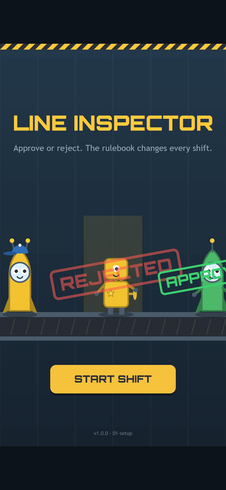
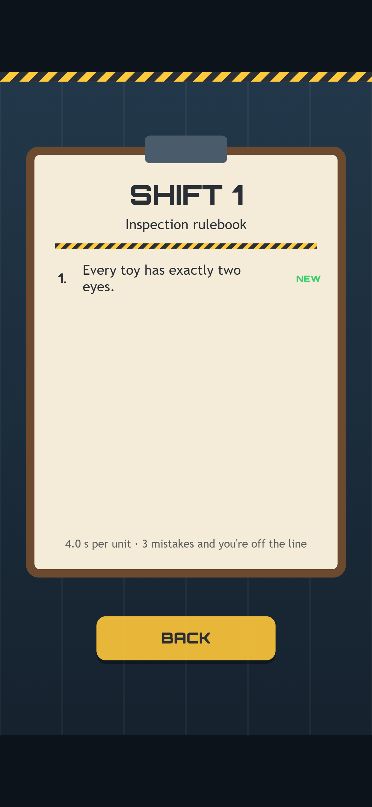
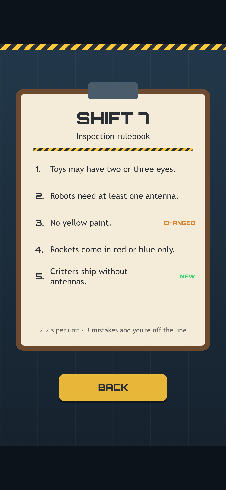
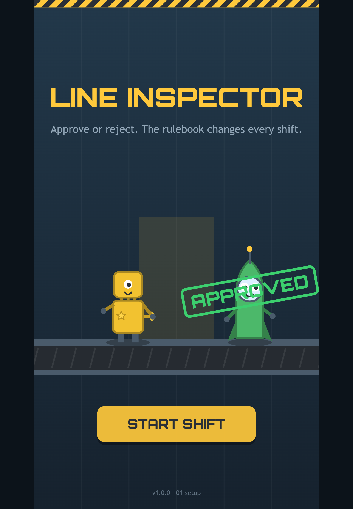

Welcome to the first Line Inspector devlog! After Orbit Hop, this is the second small HTML5 game we're building from an empty folder to a finished release, and once again we'll show you every step. Every screenshot in this series comes from a real build of the game at that stage. No mockups, no concept art painted after the fact.

This first post covers the idea: what Line Inspector is, how a shift will play out, and why we picked it. It's the plan from our design brief. The build at this stage has the title screen, the shift briefings and the toys, but you can't play a shift yet. That comes in a later post.

*The title screen on a phone. This little robot has only one eye, and the rule says two, so it gets a red REJECTED stamp.*

## The pitch

You're the quality inspector at the end of a toy factory line. Wind-up robots, bouncy critters and pocket rockets roll past one at a time, and you make one call on each: **approve** it or **reject** it.

What makes a toy good or faulty is written in the **inspection rulebook**, and the rulebook changes every shift. A toy that was fine five minutes ago might be a reject now. Make three mistakes and you're off the line.

On a phone you swipe right to approve and left to reject. On a keyboard it's the right and left arrows (or D and A). There are also two big buttons along the bottom of the screen for anyone who'd rather tap.

## How a shift works

1. **Briefing.** A clipboard shows this shift's rulebook: two to six short rules, such as "Every toy has exactly two eyes." New and changed rules are tagged so you can spot them.
2. **Inspect.** A toy rolls under the inspection lamp, and a timer bar starts draining.
3. **Call it.** Approve or reject. The toy gets a stamp and slides off: into the box if it's approved, down the chute if it isn't.
4. **Feedback.** A right call scores points and grows your streak. A wrong call, or running out of time, is a **strike**, and the rule that was broken flashes so you know why.
5. **Next shift.** Every 10 toys the shift ends. The next briefing adds or changes a rule, and you get a little less time per toy.

The rulebook stays on screen as a compact strip while you play, so this is a test of attention and speed, not memory.

*The very first briefing. One rule, four seconds per toy. It doesn't stay this calm for long.*

## The rulebook is the level design

Most of the design work in Line Inspector is in the rules. There are eight of them, and two get a changed version later on, so ten rule texts in total. Each one checks a single, easy-to-see part of a toy: the number of eyes, antennas or arms, the paint colour, or the accessory.

The interesting part is how they change over nine shifts:

- **Rules get added.** Shift 2 adds "Robots need at least one antenna." Shift 3 adds "No green paint." Each new rule is one more thing to look at.
- **Rules get changed.** In shift 5, "exactly two eyes" becomes "two or three eyes". In shift 7, "No green paint" becomes "No yellow paint". That's where it gets fun: your hands have learned the old rule, and now you have to unlearn it.
- **Rules get retired.** From shift 7 some old rules stop being checked, so the rulebook never grows past six lines. The briefing lists them as "No longer checked", so if you trip over an old habit, it's an honest mistake rather than a confusing one.
- **The clock speeds up.** You get 4.0 seconds per toy in shift 1, then 0.3 seconds less each shift, down to 1.6 seconds from shift 9 on. Shift 9 then runs on as long as you can last.

*Shift 7, straight from the build. "No green paint" has just become "No yellow paint", and critters can't have antennas any more.*

We also made a promise to the player: a faulty toy always breaks **exactly one** rule. That way, when you get a strike, the game can always tell you which rule you missed. When a rule is brand new, the next few faulty toys are more likely to break that rule, so you learn it straight away.

## Why this idea?

We had a short list of must-haves for the second game, and Line Inspector ticks all of them.

**It's different from Orbit Hop.** Orbit Hop was about timing and aim. Line Inspector is about reading, attention and changing your mind quickly. Same tech underneath, a completely different kind of game on top.

**It's quick to learn and plays the same everywhere.** Two choices, left or right. That works as a swipe, a key press or a click, and it plays in portrait so you can hold your phone in one hand.

**A run is short.** One to four minutes, and TRY AGAIN puts you straight back into shift 1. It's the kind of game you play "just once more" on the bus.

**There's a story in every mistake.** When your run ends, a "why you were stopped" card lists your three strikes, each with a drawing of the toy and the rule it broke. Losing should feel fair, and it should teach you something.

**It's full of small characters.** A robot with its cap on backwards is a rule break you can see at a glance, and it's also just quite funny. Toys are easy to read on a small screen, and they give the game a lot of personality without a single line of story.

## The look

We went for a flat, chunky toy look: rounded shapes with thick darker outlines, in glossy red, blue, yellow and green, against a cool steel-blue factory wall. Hazard-yellow stripes and rubber stamps carry the UI, and the rulebooks sit on a paper clipboard.

*On a tablet, a moment later. The title screen runs a little demo of the real game: toys roll along the belt and get stamped against the shift 1 rule.*

As with Orbit Hop, everything is drawn in code, with no image files at all. Each product line has its own body shape (boxy robot, round critter, tall rocket), so rules about one product line read at a glance even without relying on colour.

## What's next

In the next post we'll go behind the scenes on setting up: how we reused the template we built for Orbit Hop, why the game's rules were written and tested before any of the art, and the plan for testing a game whose levels are made of rules.

Thanks for reading, and see you in Devlog #2!
