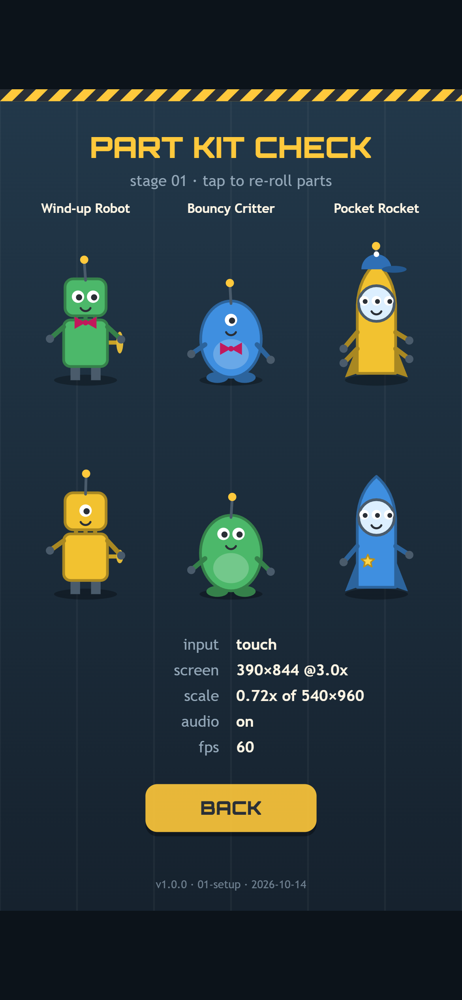
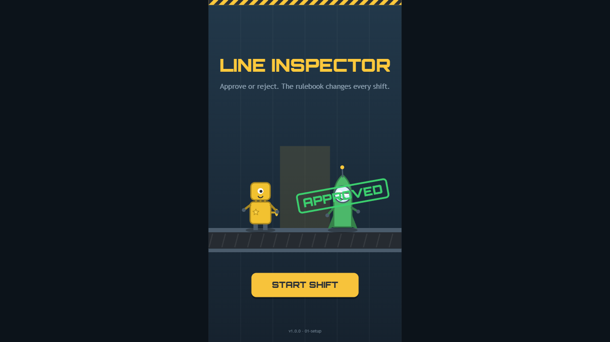
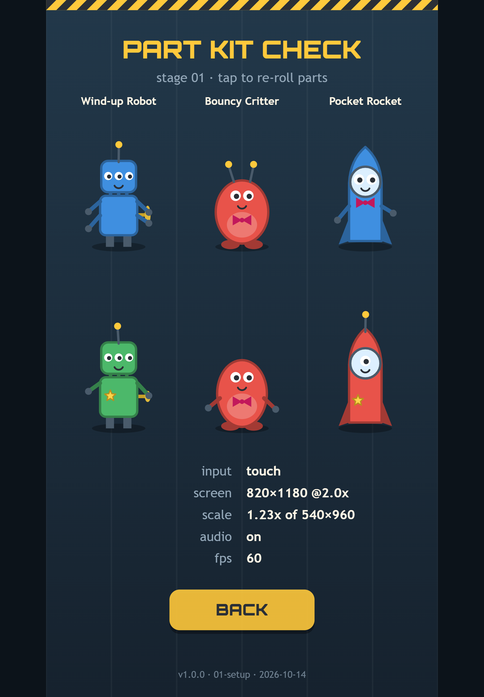
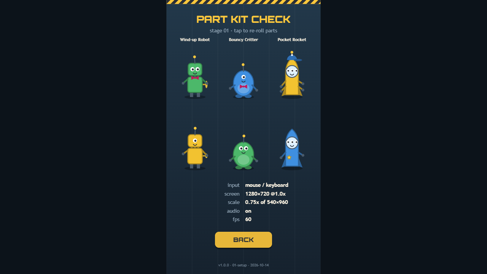

Welcome back! In [Devlog #1](../line-inspector-devlog-1-the-idea/) we introduced Line Inspector, a game about checking toys against a rulebook that changes every shift. This time we're going behind the scenes on setting up: what we reused from our first game, how we keep track of every change, and why the rules were written and tested before we drew a single toy.

There's still no playable shift in this build. But by the end of this stage we had a project with a history, a rulebook that a computer had already played 45,000 times, and a full set of toys drawn in code.



*The part kit check screen on a phone. Two of each product line, with random parts, plus a few readouts that tell us the device is behaving.*

## Starting from the template

For [Orbit Hop](../orbit-hop-devlog-2-setting-up-the-tech/) we wrote a small engine in plain TypeScript and the browser's built-in Canvas 2D: a game loop, screen scaling, input, sound, saving and a few math helpers. We built it so it knew nothing about planets or ships, so it could carry over to the next game.

Line Inspector is the test of that idea. We copied the engine and our tool scripts across **without changing a single byte**. Everything specific to Line Inspector lives in its own game folder, next to the engine rather than inside it.

That rule matters more than it sounds. The engine only knows one button, "primary", because that's all Orbit Hop needed. Line Inspector needs left and right. The easy shortcut would be to add them to the engine. Instead, swipes and arrow keys will get their own small controls file on the game side. The engine stays the same for every game, and anything one game needs stays with that game.



*The title screen in a 1280×720 desktop window. The screen scaling came straight from the template: the phone-shaped game area sits in the middle, with dark bars filling the rest.*

## Git from minute one

The very first thing we did, before copying a single file, was start a git repository. Git keeps a full history of the project: every change is saved as a "commit" with a short description, and we can always go back to any of them.

At the end of this stage the history is three commits long:

1. **Copy the template** from Orbit Hop: the engine, the scripts and the font.
2. **The rules and the run simulation**, with no graphics at all.
3. **The first screens**: the title, the shift briefing and the part kit check, plus the design brief.

Starting on day one means there's never an awkward "we'll tidy it up later" moment. If a change breaks something, we can see exactly what changed and when. We also freeze a playable copy of the game at the end of every stage, like `builds/01-setup/`, and every screenshot in this series comes from one of those copies.

## Rules first, art second

Here's the part we're happiest with. Before writing any drawing code, we wrote the whole game as plain data and functions: the parts a toy can have, the ten rule texts, the nine-shift schedule, the timer, strikes, scoring and streaks. No canvas and no sound, just logic.

Each rule is one line: the text the player reads, and a small check that says whether a toy passes. Here are three of them, straight from the game:

```ts
noGreen: { text: "No green paint.",
  pass: (u) => u.paint !== "green" },
hatForward: { text: "Hats must face forward.",
  pass: (u) => u.accessory !== "hat" || !u.hatBackwards },
rocketPaint: { text: "Rockets come in red or blue only.",
  pass: (u) => u.line !== "rocket" || u.paint === "red" || u.paint === "blue" },
```

Because the text and the check sit side by side, the words the player reads and the logic the game uses can't drift apart.

The big win is that a computer can play the game before it has any graphics. We wrote a little "perfect inspector" bot that always makes the right call, and ran it through 300 different runs of 15 shifts each. That's **45,000 toys**. It confirmed that almost exactly half the toys are faulty (0.50), which is what we aimed for. We also ran a bot that never answers at all, and it got three strikes on the first three toys, which is exactly what should happen.

It also caught a real bug. We promise the player that a faulty toy breaks **exactly one** rule, so the game can always tell you which rule you missed. Out of those 45,000 toys, one broke two rules at once. The toy maker builds a random toy and keeps trying until it gets one that breaks just the rule it wants. Very occasionally it ran out of tries, so we gave it ten times as many. One toy in 45,000 is the kind of bug no play-tester would ever find by hand.

## One function draws every toy

With the rules settled, we drew the toys, all in code, with no image files. One function takes a toy's parts and draws it: the body for its product line, then eyes, antennas, arms, paint and accessory on top. Toys also blink, wobble their antennas, turn their wind-up keys and squash a little while they wait.

Three product lines, one to three eyes, zero to two antennas, zero, two or four arms, four paints and five accessory options (none, a cap facing forward, a cap facing backwards, a bow tie or a star badge) make **1,620 different toys** from a few hundred lines of drawing code.



*The same screen on a tablet, after re-rolling twice. The three-eyed robots and the one-eyed red rocket would all fail "Every toy has exactly two eyes."*

The part kit check screen shows six random toys at a time, and a tap or Space re-rolls them. It's our quick way to make sure every part reads clearly at phone size. Underneath are the same device readouts we had in Orbit Hop: input type, screen size, scale, audio and frame rate.



*On desktop the readouts switch to mouse and keyboard. The whole game is still a single 38 KB JavaScript file.*

## The plan for testing

A game whose levels are made of rules needs testing that understands rules. In the next stage, our automated level check will be rewritten for Line Inspector to run four kinds of test:

- **A perfect bot** that has to survive every shift on every random seed, which proves no toy is impossible to judge.
- **An "exactly one rule" check** on every faulty toy.
- **A spread check** that counts how often each rule gets broken in each shift, so no rule is forgotten.
- **A "human" bot** with a realistic reaction time and the occasional mistake, to tune how fast the timer should shrink.

We'll also test in Safari's engine, not just Chrome. That's already paying off: in this build Safari draws our title font in a thinner weight than intended, and it's on the list to fix.

## What we've got so far

- An idea and a design brief (see [Devlog #1](../line-inspector-devlog-1-the-idea/))
- Our Orbit Hop engine and tools, reused without changes
- A git history from the very first minute
- The complete rulebook and run logic, already played 45,000 times by a bot
- 1,620 possible toys, drawn and animated in code
- A title screen, shift briefings and a part kit check screen

## What's next

Next up is the prototype: making it playable. In Devlog #3 we'll get toys rolling under the lamp for real, with swipes and arrow keys, the timer bar, stamps and strikes, and the first full shift you can actually lose.

See you then!
