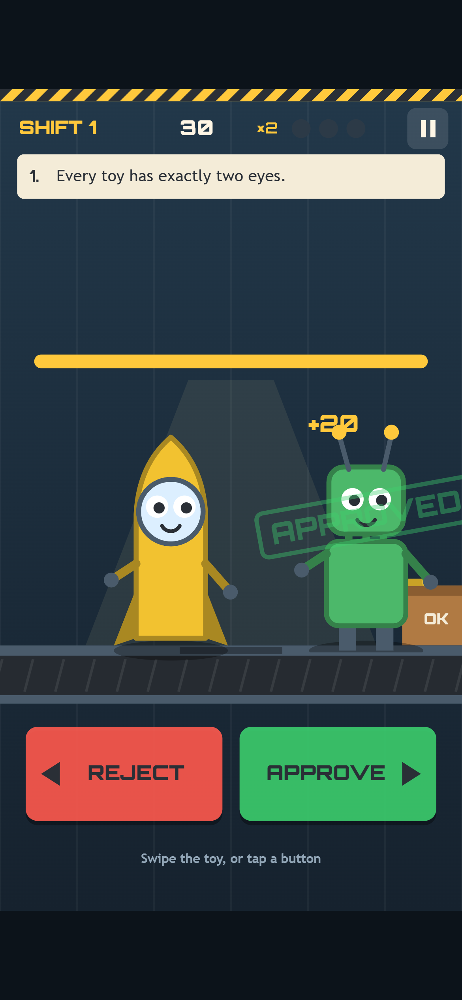
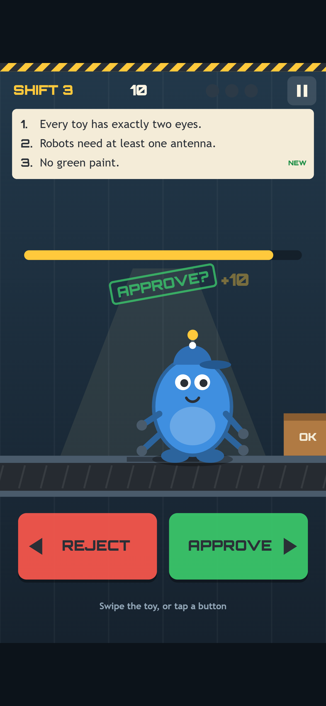
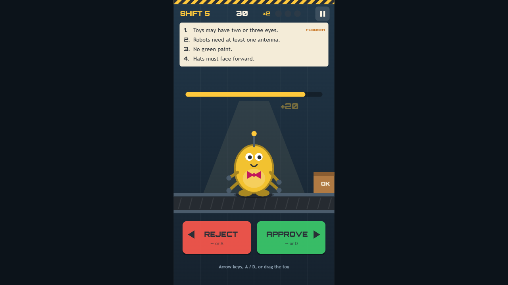
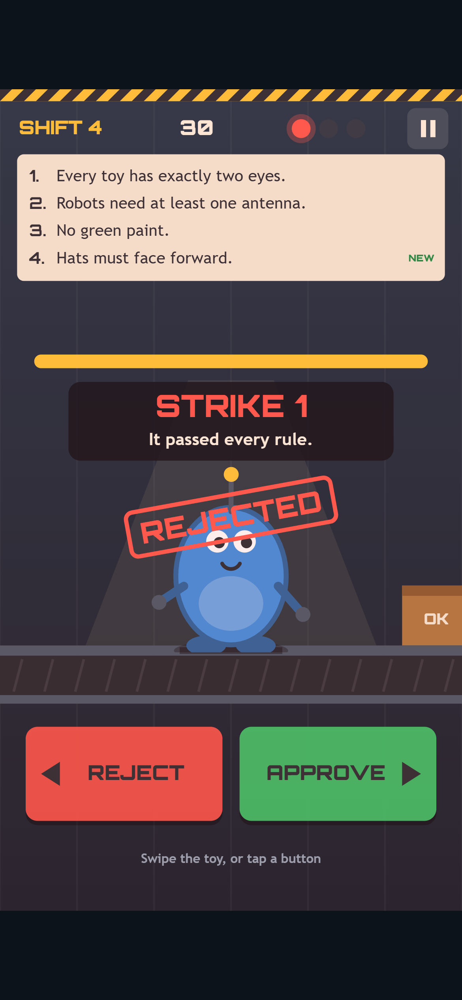
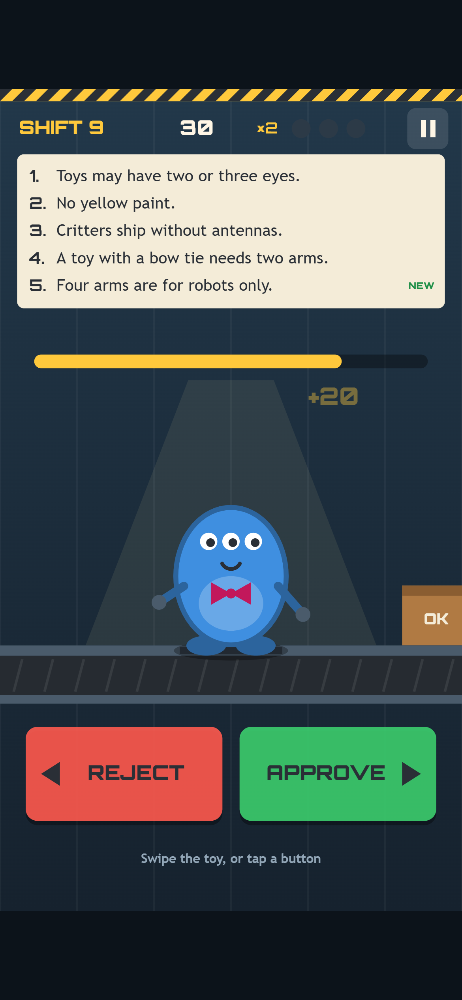

Welcome back! In [Devlog #2](../line-inspector-devlog-2-setting-up/) we set up the project and wrote the whole rulebook before drawing a single toy. The toys could blink and wobble, but you couldn't actually inspect any of them.

That changes in this post. The prototype is the first build you can really play: toys roll under the lamp, you approve or reject them, the rulebook changes between shifts, and three mistakes send you home. We'll walk through the inspection loop, explain how the game builds a fair toy every time, and share what our test bots found when they played it thousands of times.

*A right call in shift 1. The robot gets its APPROVED stamp and heads for the box, and the next toy is already waiting under the lamp.*

## The inspection loop

A run goes like this: the title screen, then a shift briefing on a clipboard, then the inspection station. Every ten toys you see a "SHIFT COMPLETE" card, then the next briefing with that shift's new or changed rules. You keep going until you collect three strikes.

The inspection screen packs everything onto one phone-sized view. Across the top are the shift number, your score, your streak bonus and three strike lights. Under that is the rulebook strip, with every active rule numbered and always visible. Then comes a timer bar, the toy under its lamp, and two big REJECT and APPROVE buttons.

A right call stamps the toy and sends it on its way. Approved toys slide right into the box, and rejected toys drop through a trapdoor. Each right call adds points, and a run of right calls in a row multiplies them.

## Swipe, drag, tap or press

The controls were the part we cared most about getting right. On a phone you swipe the toy: right to approve, left to reject. While your finger is down the toy follows it, and an "APPROVE?" or "REJECT?" stamp hovers over it, so you can see what you're about to do before you let go.

*Mid-swipe in shift 3. The toy follows your finger and a preview stamp shows which way the call will go.*

A swipe has to travel at least 60 pixels sideways to count, so a nervous wobble doesn't judge a toy by accident. With a mouse you can drag the same way. On a keyboard it's the arrow keys or A and D, and the buttons work everywhere.

Two small details stop frustrating mistakes. First, after each call the game ignores new input for a moment while the toy leaves (0.3 seconds, or 0.9 after a strike), so a double swipe can't judge the next toy before you've seen it. Second, the page never scrolls or zooms while you play, even if you swipe enthusiastically.

*On desktop the buttons show their keys, and the hint underneath switches to arrow keys, A and D. Rule 1 has just changed, so it carries a CHANGED tag.*

## When you get it wrong

There are three ways to earn a strike: approving a toy that breaks a rule, rejecting a toy that passes every rule, or running out of time. Each one gets a stamp of what you called, a "STRIKE" banner with a short reason, a red flash and a buzz.

We wanted every strike to teach you something. If a toy broke rule 4, the banner says "It broke rule 4." and that rule flashes in the strip. If it was fine all along, the banner says so.

*Our first strike in shift 4. The critter has an antenna, but the antenna rule only applies to robots, so rejecting it was the mistake.*

The timer is where the pressure comes from. In shift 1 you have 4 seconds per toy. That shrinks each shift until it reaches 1.6 seconds at shift 9. At the same time the rulebook grows from one rule to five, and rules start to change. "Every toy has exactly two eyes" becomes "Toys may have two or three eyes", and the green paint ban turns into a yellow one.

*Shift 9: five rules, 1.6 seconds per toy. This three-eyed critter is fine. Three eyes are allowed now, and its bow tie comes with exactly two arms.*

## Building a fair toy, every time

The game makes one promise that everything else depends on: a faulty toy breaks **exactly one** rule. That way the game can always tell you which rule you missed, and you never get a strike for a toy that was wrong in two ways at once.

In the last build, the toy maker built random toys and kept trying until one broke the rule it wanted. That nearly always worked, but "nearly" isn't a promise. So for the prototype we rewrote it.

There are 1,620 different toys you can build from the part kit. Now the game lists all of them once, when it starts. When it needs a toy for a shift, it checks that list against the current rules and keeps only the toys that break exactly the rule it's after (or no rules at all, for a good toy). Then it picks one at random from that shortlist.

That turns "exactly one rule" from something we hoped for into something that's true by design. Our tests also check that the shortlist is never empty. The smallest one, for any shift and any rule, still has 36 toys to choose from.

## What the bots found

We can't play-test every possible shift by hand, so a set of bots does it for us. Our level check plays 300 different random runs, and if anything looks wrong it fails the build. Here's what they reported for this prototype:

- **45,000 toys checked, none ambiguous.** Exactly half were faulty, and not one broke two rules at once.
- **The perfect inspector**, which always makes the right call, reached shift 15 without a single strike on all 300 runs. It still did with a slow 1.2-second reaction time, so no shift is impossible.
- **The random clicker** lasted a median of 5 toys. **The bot that never answers** lasted exactly 3, all timeouts, which is what should happen.
- **The "human" bot** reads each rule at a realistic speed and makes the occasional mistake. It inspected a median of 83 toys, and 55% of its runs reached shift 9. At the fastest timer with five rules, a typical decision took 1.09 of the 1.6 seconds, and about 4% of toys timed out. That feels tense but fair, which is what we were aiming for.

The bots also measure how big each detail is on a small 360×640 phone screen. Eyes are 13.5 pixels across, a cap turned backwards moves its brim by 50 pixels, and the buttons are 73 pixels tall. If any rule's detail gets too small to see, the build fails.

A second test drives the real game in Chrome and in Safari's engine, using real key presses, clicks, mouse drags and touch swipes. It plays a full run from the title screen to game over and back, and checks that the page never scrolls or zooms along the way.

## The game-over card

When your third strike lands, the shift is over. The card lists every strike with a small drawing of the toy and the exact rule it broke, so you know what to watch for next time.

*The game-over card names the rule behind every strike. TRY AGAIN puts you straight back on the belt.*

It also shows your units, score, best streak and high score, with a NEW BEST! stamp when you beat it. COPY RESULT copies a short line to share with friends.

## What we cut

We had planned a "RULES" button to peek at the full rulebook mid-shift. Once the strip showed every rule in full, the button just repeated it, so we cut it. Sound is still placeholder tones, and the box and trapdoor are simple shapes for now.

## What we've got so far

- A design brief and an idea (see [Devlog #1](../line-inspector-devlog-1-the-idea/))
- Our reused engine and a rulebook tested from day one (see [Devlog #2](../line-inspector-devlog-2-setting-up/))
- A complete, playable loop: briefings, nine shifts of changing rules, three strikes and a game-over card
- Swipe, drag, keyboard and button controls, tested in two browser engines
- A toy maker that guarantees every faulty toy breaks exactly one rule
- Bots that check 45,000 toys on every build

## What's next

Next comes production: the part that makes it feel like a real factory. We're planning music and sound effects, a belt hum, a stamp that slams with a bit of screen shake, a proper box and chute, and patterns on the paint colours so red and green toys are easy to tell apart for colour-blind players. We'll also add Settings, How to Play and Credits screens.

See you then!
