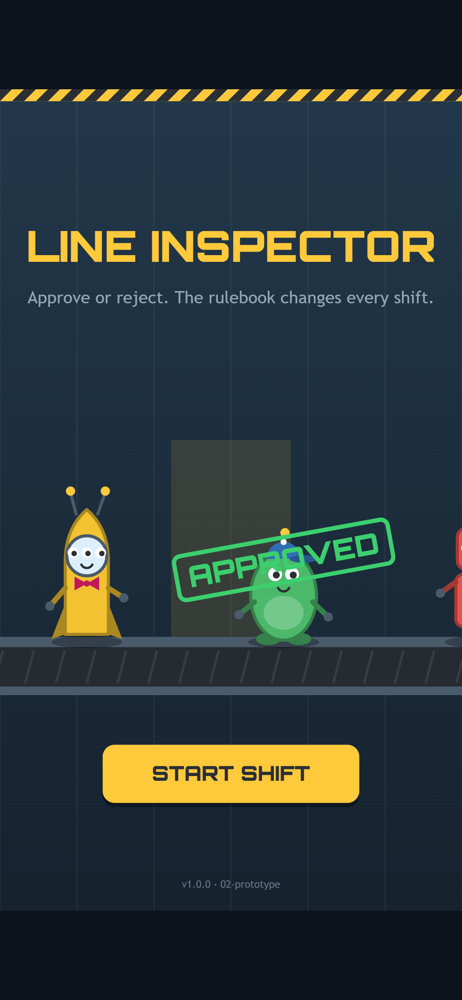
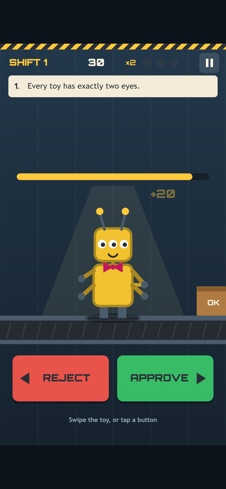
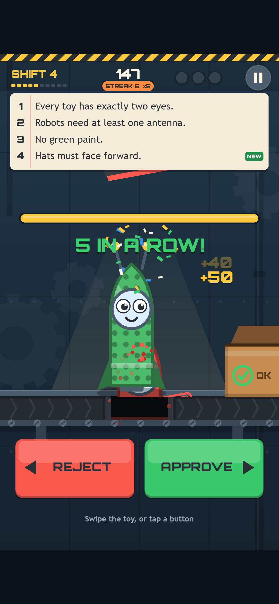

Welcome back! In [Devlog #3](../line-inspector-devlog-3-first-playable/) the belt started moving. The prototype played well, and our test bots were happy with it, but it still looked and sounded like a prototype: flat shapes, placeholder tones and a single START SHIFT button.

This post is about production, the stage where a working game turns into one that feels good to play. We'll go through the new art, the colour-blind patterns, the sound and music, the menus and the share line, and all the small touches that make a right call feel satisfying. Most sections come with a before-and-after from the same moment in the prototype and the new build.

*The production title screen. The logo is now a factory sign and a rubber stamp, and the menu has grown from one button to five.*

## A factory to work in

The prototype did the job, but it didn't feel like a place.

*Before: the prototype title screen. Same toys, same stamp, much less of a factory.*

For production we built a proper workplace. The wall is made of riveted panels with big gears turning slowly behind them. The lamp throws a cone of light over the inspection spot. The belt has rollers underneath and chevrons that move along it, so you can tell it's running even when no toy is on it.

Approved toys now slide into a cardboard OK box with a green tick on it. Rejected toys drop through a trapdoor in the belt, which you can see marked out with a dashed red outline. The APPROVED and REJECTED stamps have an ink texture, like a real rubber stamp that's been used a few thousand times.

*Before: shift 1 in the prototype.*

*After: the same moment in shift 1. The HUD also gained a row of progress dots for the shift and a streak badge.*

None of this uses image files. Every gear, box, toy and stamp is drawn by the game's code each frame. The game script grew from about 55 KB to about 86 KB, and all of that growth is code for the art, sound and menus. There are still zero image files and zero audio files in the build.

## Paint you can read without colour

Several rules are about paint: "No green paint", and later "No yellow paint". That's a problem if you can't easily tell red from green, which is true for a lot of players.

So every paint colour now has a pattern as well. Red and blue stay plain, yellow gets diagonal stripes, and green gets dots. You can see the stripes on the critter above. The How to Play screen spells it out, so you know to look for them.

We also added a check to our automated tests. It simulates the most common type of colour blindness, and if two paints would look alike *and* share the same pattern, the build fails. That way, if we ever add a new colour, we can't accidentally make a rule unreadable.

## Sound and music, with no audio files

All the sound in Line Inspector is made live in the browser, using the built-in Web Audio system to shape simple tones and noise. Every effect has a small job:

- **The stamp** is a dull wooden thud plus a paper slap.
- **An approval** adds a ding that climbs in pitch as your streak grows, so a long streak sounds like it's going somewhere.
- **A rejection** adds the clunk of the trapdoor and a low drop.
- **A strike** is the stamp followed by a two-tone alarm buzzer.
- **The last second** of the timer ticks like a clock.
- **A new shift** blows a factory whistle, and **game over** sounds like the line winding down.

Under it all is a soft belt hum, a low rumble that fades in while the belt is running.

The music is a short, cheerful factory groove: a four-bar loop with a plucked bass, a wood block and a marimba tune. It changes with the game. On the menus it plays quietly. Once you're on the belt, a soft kick drum and hi-hat join in. Hit a streak of five and a shaker and a high second melody come in on top. Each shift also nudges the tempo up a little, from 104 beats per minute to a cap of 130, so the music keeps pace with the shrinking timer.

Browsers don't allow sound until the player interacts with the page, so nothing plays until your first tap or key press. A new test checks exactly that, and also checks that the speaker button mutes the game, that mute is remembered after a reload, and that the M key works anywhere.

## Menus that explain themselves

The title screen now has HOW TO PLAY and CREDITS buttons, a gear for Settings and a speaker button for sound. Most screens use the same clipboard look as the shift briefings, so they feel like part of the factory.

*How to Play uses drawings of the real toys, so you can learn the game in a few seconds. It's also in the pause menu.*

Settings has switches for music, sound effects, screen shake and vibration, plus a button to clear your best score. That button needs two taps, so you can't wipe your record by accident. The pause menu lets you resume, read How to Play, toggle sound or quit, and the game pauses itself if you switch to another tab.

Between shifts there's now a proper shift-change card. It shows how you did, then lists the next shift's rules under NEW, CHANGED and NO LONGER CHECKED, along with your new time per toy. Rules that are dropped get their own heading, so you know you can stop checking them.

## Juice: making every call feel good

"Juice" is what game developers call the small bits of feedback that make an action feel good. In a game of hundreds of quick decisions, it keeps the hundredth call as satisfying as the first.

Every stamp now slams down with a few specks of ink and a tiny screen shake. The score counts up instead of jumping. The streak badge bumps on every right call and turns orange from five in a row.

*Five right calls in a row. The green rocket breaks "No green paint", so down the trapdoor it goes, with confetti and a bonus.*

Every fifth call in a row gets confetti and a "5 IN A ROW!" banner (then 10, 15 and so on). Strikes go the other way: sparks, a red flash and a bigger 12-pixel shake, so you feel the mistake without it being harsh. On phones that support it, strikes and milestones also vibrate. If screen shake isn't for you, you can turn it off in Settings.

## A game-over card worth sharing

The game-over card kept its most important job from the prototype: it lists all three strikes with a drawing of the toy and the rule it broke. Now it's on a clipboard, with a short line at the top: "The line stops here for today."

*The result box shows exactly what COPY RESULT copies: your units, your last ten calls as green and red squares, and your score.*

The new part is the share line. It's small enough for a chat message, and the squares tell the story of how your shift ended. When you beat your best score, a NEW BEST! stamp lands with its own little jingle.

## What we've got so far

- A design brief and an idea (see [Devlog #1](../line-inspector-devlog-1-the-idea/))
- Our reused engine and a rulebook tested from day one (see [Devlog #2](../line-inspector-devlog-2-setting-up/))
- A complete, playable loop with bots checking 45,000 toys on every build (see [Devlog #3](../line-inspector-devlog-3-first-playable/))
- A drawn factory with a moving belt, an OK box, a trapdoor and inked stamps, all in code
- Patterns on every paint colour, with a test that keeps them readable
- Synthesised sound effects and layered music that speeds up each shift
- Title, How to Play, Settings, Credits and Pause screens, a shift-change card and a share line

## What's next

The next stage is testing and release. We'll run the game across browsers and screen sizes, try it on real phones (including how sound starts on iPhones and how vibration feels on Android), and check that the music's top speed feels right when you play past shift 9. Then Line Inspector goes live on the site.

See you then!
