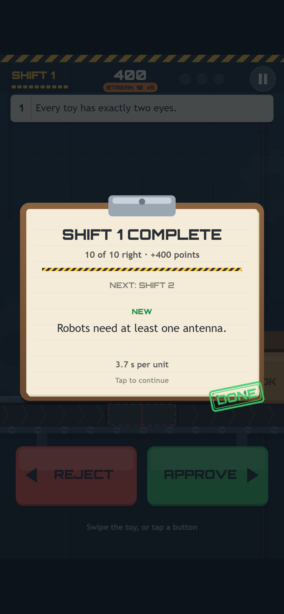
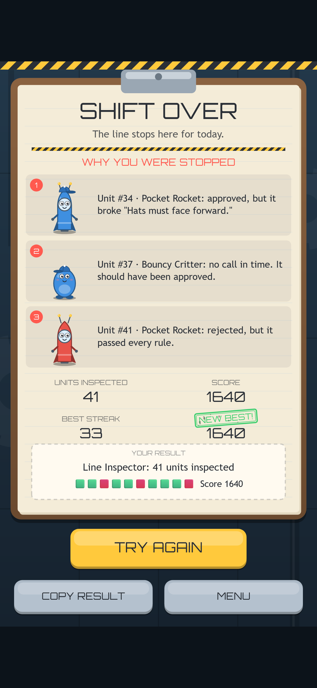
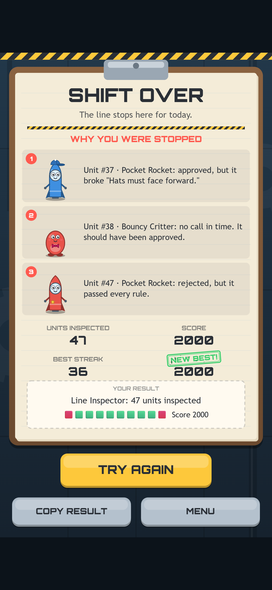
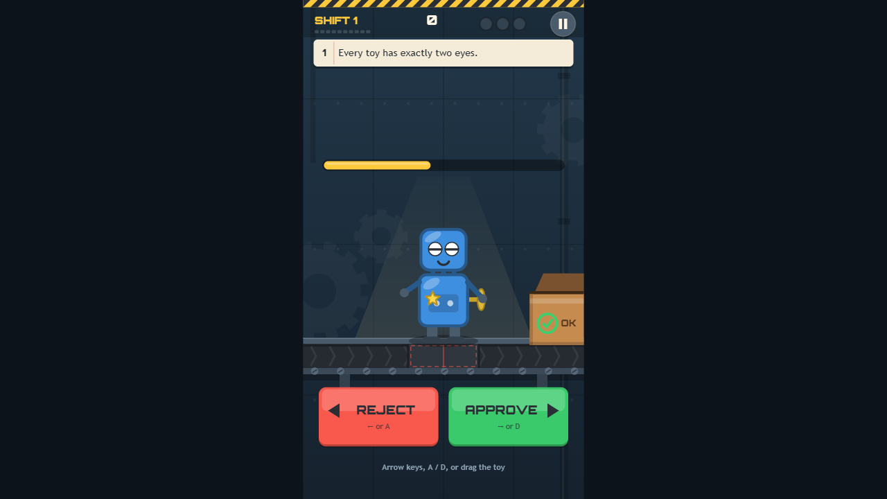
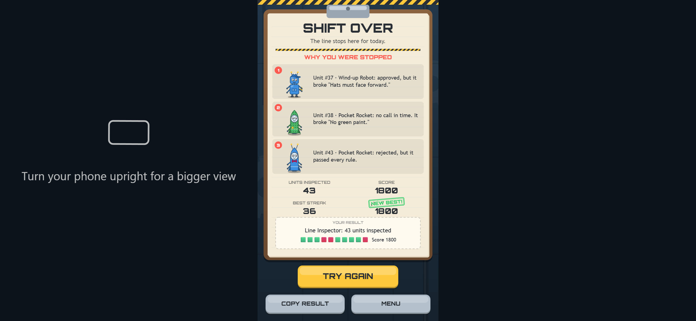

Welcome back! In [Devlog #4](../line-inspector-devlog-4-look-and-feel/) the factory got its paint, its sound and its menus. Line Inspector looked and sounded finished. The next job was to find out whether it actually *was* finished.

This post is about testing. We ran the game in four browser engines at four screen sizes, let a bot play complete runs in every one of them, and then sat down and read the code line by line. The robots passed everything. The reading found seven bugs anyway.

*Our test bot making its third mistake on purpose. It rejected a rocket that passed every rule, exactly as its script told it to.*

## Four engines, not three

Most of the web runs on three browser engines: Chromium (Chrome and Edge), Gecko (Firefox) and WebKit (Safari). When we tested [Orbit Hop](../orbit-hop-devlog-5-testing-and-polish/), we covered Chrome, Edge and Firefox. This time we added WebKit, the engine behind Safari on every iPhone and iPad.

That matters for a swipe game. Plenty of players will open Line Inspector on an iPhone, and Safari has its own ideas about touch, scrolling and sound.

Every browser ran at four sizes: desktop, an upright phone, the same phone turned sideways, and a tablet. The touch sizes use real touch input, not mouse clicks dressed up as taps. We ran everything twice: once served from the exact folder path the game will have on our website, and once opened straight from disk. The web run also fails if the game asks for any file outside its own folder.

Four browsers, four sizes, two ways of opening it and six checks each: **192 checks, and all 192 passed.** Orbit Hop's final run was 90 out of 90 in three browsers.

## A bot that plays a whole shift

Five of the six checks are quick: every screen opens without errors, the menus and pause work, sound stays off until your first tap, swipes are read correctly, and switching tabs pauses the game.

The sixth is the big one. A bot plays a complete run in real time, with real key presses on desktop and real taps on touch screens. It reads the rulebook and makes the right call for three full shifts.

*The bot's first shift: ten right calls out of ten. None of these screenshots is staged. They're captured while the bot plays.*

Then it makes three mistakes on purpose, one of each kind: it approves a faulty toy, lets one run out of time, and rejects a good one. That's how a run ends, so it's the part we most need to check. The bot confirms that the game-over card lists all three mistakes, that the best score is saved, and that the title screen shows the new best afterwards.

Across all 32 combinations, the bot's runs ended in shift 4 or 5, with 40 to 47 toys inspected and scores from 1,590 to 2,000.

## WebKit's turn

WebKit passed every check, but it taught us a couple of things.

*The same game-over card in WebKit. It all works, but the bold display font comes out noticeably thinner than in the other browsers.*

The test version of WebKit on our machines draws everything in software, without a graphics card. At phone and tablet sizes it managed 14 to 40 frames per second, where the other browsers held a steady 60. But the game's rules run on a fixed clock that doesn't depend on the frame rate, so even at 14 fps every timer, score and strike came out right. That says nothing about a real iPhone's speed, but it shows the game stays fair on a slow device.

That test WebKit also has no sound system, so the game runs silently there with no errors. For sound on iPhones, we had to rely on reading the code.

## Seven bugs no test could see

Before the big test run, we read the code by hand, focusing on where browser games usually go wrong: sound, touch, switching apps and saving. We found seven bugs. Here are our two favourites.

**The TRY AGAIN trap.** When your third strike lands, the game-over card appears. Its big yellow TRY AGAIN button sits almost exactly where the APPROVE and REJECT buttons were a moment before.

*Compare the TRY AGAIN button with the APPROVE and REJECT buttons in the first screenshot. They're in nearly the same spot.*

So a tap a fraction of a second too late on your last toy could land on TRY AGAIN and throw you into a new run before you'd seen why you lost. Our bot never did this, because it waits politely for each screen. A flustered player would. Now the card ignores taps for its first 0.6 seconds, and the bot has a new job: it taps 0.1 seconds after the card opens and checks that the card stays put.

**Silent iPhones.** Browsers won't play sound until you interact with the page, so the game starts its sound on your first tap. Older versions of Safari on iOS are stricter: they only switch sound on if a sound actually *starts playing* during that tap. Our game didn't play anything on the first tap, so on those phones it could have stayed silent all run, and our silent test WebKit could never have noticed. The fix is tiny: the first tap now plays a sound one sample long and completely silent, which is enough to wake the audio up.

The other five, all fixed:

- The demo game-over card we use for screenshots could overwrite your saved best score.
- The game paused when you hid the tab, but not when you alt-tabbed or switched apps. Now it pauses for both.
- A swipe interrupted by a notification could stay half-finished. It's now cleared.
- Alt + ← (the browser's Back shortcut) counted as a REJECT, and Ctrl + D as an APPROVE. Shortcuts with Alt, Ctrl or Cmd are now ignored.
- A damaged or edited saved score could show up as nonsense on the title screen. Saved scores are now checked when they're loaded.

## A last pass over the words

We also re-read every piece of text a player can see and made four small fixes. The most useful: How to Play said "swipe" on desktop, where you actually drag the toy with your mouse. It now uses the right word for your device.

*On desktop, every hint talks about keys and dragging, not swiping.*

The title screen also now shows just the version number, v1.0.0. The phone landscape run checked one more message: when you turn your phone sideways, the game suggests turning it back upright for a bigger view.

*Line Inspector is a portrait game. Sideways still works, and it tells you how to get a bigger view.*

## What we've got so far

- A design brief and an idea (see [Devlog #1](../line-inspector-devlog-1-the-idea/))
- Our reused engine and a rulebook tested from day one (see [Devlog #2](../line-inspector-devlog-2-setting-up/))
- A complete, playable loop with bots checking the rulebook on every build (see [Devlog #3](../line-inspector-devlog-3-first-playable/))
- A drawn factory, synthesised sound and music, and proper menus (see [Devlog #4](../line-inspector-devlog-4-look-and-feel/))
- 192 out of 192 checks passing in Chrome, Edge, Firefox and WebKit, at four screen sizes
- A bot that plays full runs and checks how they end
- Seven bugs found by reading the code and four wording fixes, all made before release
- Version 1.0.0, saved as a snapshot that won't change

## What's next

Line Inspector 1.0.0 is ready to publish. Next we put it on the website, and then we'll play it on real phones to check how it feels in the hand, from how sound starts on an iPhone to how swipes feel on Android. In the last post we'll take a tour of the finished game and look back at what we learned making it.

See you then!
