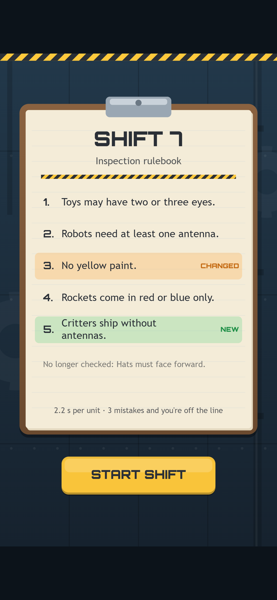
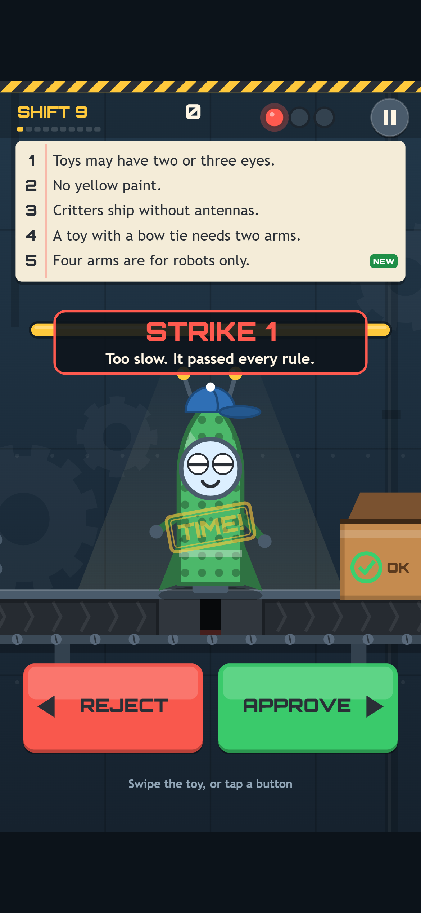
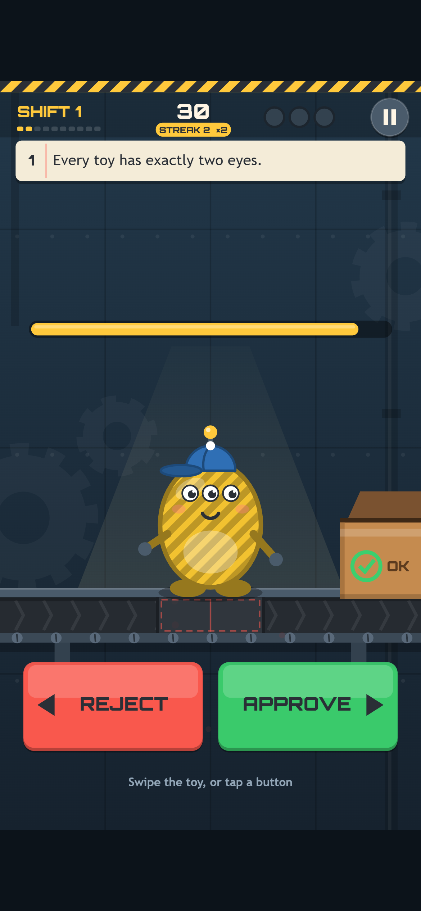

[Line Inspector](/ko/games/line-inspector/)(라인 인스펙터)는 플레이어를 장난감 공장 라인 끝에 앉혀 놓는 게임이에요. 태엽 로봇, 통통 동물, 포켓 로켓이 하나씩 조명 아래로 굴러 오고, 장난감마다 판정은 한 번이에요. 오른쪽으로 스와이프하면 통과해서 상자에 들어가고, 왼쪽으로 스와이프하면 불량이라 함정 문으로 떨어져요. 무엇이 불량인지는 규정집에 적혀 있고, 규정집은 근무마다 바뀌어요. 3번 틀리면 라인이 멈춰요.

이 글에서는 이 게임 뒤에 있는 결정들을 이야기해요. 규칙으로 레벨을 설계한 방법, 그래픽이 생기기 전에 봇으로 그 규칙을 테스트한 일, 코드로 그린 공장과 사운드트랙, 그리고 코드를 읽어서야 찾은 버그들이에요. 스크린샷은 전부 실제 게임 빌드에서 찍었어요.


*연속 5번 정답. 초록 로켓은 "No green paint"를 어겼으니 함정 문으로 내려가요.*

## 규정집이 곧 레벨 디자인

Line Inspector의 디자인은 대부분 규정에 들어 있어요. 규정은 8개이고, 각각 장난감에서 눈에 잘 띄는 부분 하나를 검사해요. 눈, 안테나, 팔, 도색 색상, 액세서리 중 하나예요. 근무 한 번은 장난감 10개이고, 근무와 근무 사이에 규정집은 세 가지 방식 중 하나로 바뀌어요.

- **규정이 추가돼요.** 살펴볼 게 하나 더 늘어요.
- **규정이 바뀌어요.** "눈 정확히 2개"가 "눈 2개 또는 3개"가 되고, "초록 도색 금지"가 "노랑 도색 금지"가 돼요. 손은 이미 옛 규정을 익혔고, 이제 그걸 잊어야 해요. 게임이 재미있어지는 건 바로 여기예요.
- **규정이 폐지돼요.** 그래서 규정집은 여섯 줄을 넘지 않아요.

한편 제한 시간은 점점 짧아져요. 근무 1에서는 장난감당 4초, 근무 9부터는 1.6초예요.



*근무 7 브리핑. 이제 초록 도색은 괜찮고 노랑은 안 되고, 모자는 더 이상 신경 쓰지 않아도 돼요.*

잊는 게 어려운 부분이니까, 규정만이 아니라 바뀐 점을 가르쳐 줘요. 브리핑마다 규정에 NEW, CHANGED, NO LONGER CHECKED 표시를 붙이고, 플레이 중에는 규정집 전체가 띠 모양으로 화면에 남아 있어요. 규정이 바뀐 직후에는 바뀐 규정에 걸리는 장난감이 벨트에 가장 자주 나와요. 기억력 시험이 아니라 집중력과 속도 시험이에요.

## 모든 실수에는 이유가 있다

플레이어와 약속 하나를 했고, 나머지는 전부 그 약속에 기대고 있어요. 불량 장난감은 언제나 규정을 **딱 하나만** 어겨요. 그래서 경고를 받으면 게임이 어떤 규정을 놓쳤는지 항상 알려 줄 수 있어요.



*근무 9에서 망설이다 받은 경고. 초록 도색과 거꾸로 쓴 모자는 근무 몇 번 전만 해도 문제였지만, 지금 이 로켓은 전부 통과예요.*

처음 만든 장난감 생성기는 무작위로 장난감을 만들어 원하는 규정을 어길 때까지 계속 시도했어요. 거의 항상 통했지만, "거의"는 약속이 아니에요. 부품 키트로 만들 수 있는 장난감은 1,620가지예요. 그래서 이제 게임은 시작할 때 전부 한 번 나열해 두고, 필요한 장난감마다 목표 규정만 정확히 어기는 것(좋은 장난감이면 아무것도 어기지 않는 것)만 후보로 추려요. 덕분에 약속은 구조적으로 지켜질 수밖에 없고, 후보 목록이 비는 일이 없다는 것도 테스트로 확인해요. 가장 작은 목록에도 장난감이 36개 들어 있어요.

세 번째 경고를 받으면 게임 오버 카드에 모든 실수가 나열돼요. 장난감 그림과 어긴 규정이 같이 나와요. 왜 졌는지 알려 주는 게임은 다시 하고 싶은 게임이에요.

## 규칙이 먼저, 그래픽은 그다음

그림을 하나도 그리기 전에 게임 전체를 순수한 로직으로 먼저 만들었어요. 부품, 규정, 근무 일정, 타이머, 경고, 점수예요. 규정은 한 줄에 플레이어가 읽는 문구와 게임이 실행하는 검사를 같이 담아서, 둘이 어긋날 수 없어요.

```ts
noGreen: { text: "No green paint.",
  pass: (u) => u.paint !== "green" },
hatForward: { text: "Hats must face forward.",
  pass: (u) => u.accessory !== "hat" || !u.hatBackwards },
```

덕분에 그래픽이 생기기 전부터 봇이 게임을 플레이할 수 있었어요. 레벨 검사는 무작위 플레이 300판, 장난감 총 45,000개를 돌려서 뭔가 이상하면 빌드를 실패시켜요. 완벽한 검수원은 반응 속도가 1.2초로 느려도 모든 근무를 버텨야 해요. 그래서 불가능한 근무는 없어요. 아무 판정도 하지 않는 봇은 정확히 시간 초과 3번에 져야 해요. "사람" 봇은 현실적인 속도로 규정을 읽고 가끔 실수해요. 가장 빠른 타이머에서는 제한 1.6초 중 보통 1.09초를 썼는데, 긴장되지만 공정한 느낌이었어요. 작은 휴대폰 화면에서 세부 요소 크기를 재서, 규정의 디테일이 보기 힘들 만큼 작아지면 실패시키기까지 해요.

이 게임은 Orbit Hop의 엔진을 한 바이트도 고치지 않고 그대로 가져다 썼어요. 엔진은 버튼 하나만 알고, 왼쪽과 오른쪽은 게임 자체의 조작 파일에 있어서 어느 게임이든 엔진은 그대로예요.

## 코드로 그린 공장, 그리고 그루브

Line Inspector에도 이미지나 오디오 파일이 없어요. 장난감, 톱니바퀴, 상자, 도장까지 전부 코드로 그리고, 게임 전체가 약 84KB짜리 스크립트 하나예요. 분위기는 두꺼운 윤곽선의 통통한 장난감과 강철빛 푸른 공장 벽이고, 메뉴에는 위험 줄무늬, 잉크 묻은 고무 도장, 클립보드를 썼어요.


*전: 프로토타입의 근무 1. 플레이는 잘 됐지만 공장에 와 있다는 느낌은 없었어요.*



*후: 완성본의 같은 순간. 톱니바퀴, 움직이는 벨트, 함정 문, 제대로 된 OK 상자가 생겼어요.*

규정 여러 개가 도색에 관한 거라서 색만으로는 부족했어요. 이제 도색마다 무늬도 있어요. 노랑은 줄무늬, 초록은 물방울무늬예요. 가장 흔한 유형의 색각 이상을 시뮬레이션하는 테스트가 있어서, 두 도색이 비슷해 보이면서 무늬까지 같으면 빌드를 실패시켜요. 품은 거의 안 드는데, 훨씬 더 많은 사람이 즐길 수 있게 돼요.

사운드도 실시간으로 합성해요. 도장을 찍으면 나무가 쿵 울리고 종이가 찰싹 소리를 내요. 통과하면 "딩" 소리가 나는데, 연속 기록이 늘수록 음이 높아져요. 경고는 두 음짜리 부저예요. 음악은 뜯는 베이스, 우드블록, 마림바로 만든 짧은 공장 그루브예요. 검수가 시작되면 킥 드럼과 하이햇이 들어오고, 연속 5번이 되면 셰이커와 두 번째 멜로디가 들어와요. 근무마다 템포가 조금씩 올라가서 104에서 최대 130BPM까지 가고, 줄어드는 타이머에 음악이 보조를 맞춰요.

## 브라우저 엔진 넷, 그리고 코드를 읽어서 찾은 것

테스트를 위해 봇이 Chrome, Edge, Firefox, WebKit(Safari의 엔진)에서 게임을 열어요. PC, 휴대폰, 가로 휴대폰, 태블릿 크기로, 터치 크기에서는 진짜 터치 입력으로요. 봇은 3번의 근무를 올바르게 플레이한 뒤, 일부러 3번 틀려요. 종류별로 하나씩이에요. 그리고 게임 오버 카드와 최고 기록이 제대로 나오는지 확인해요. 192개 검사를 전부 통과해요.

봇은 전부 통과했어요. 그래도 코드를 직접 읽어서 버그 일곱 개를 찾았어요. 제일 마음에 드는 건 이거예요. 게임 오버 카드의 큼직한 TRY AGAIN 버튼이 방금까지 통과와 불량 버튼이 있던 자리와 거의 똑같은 곳에 있어요.


*TRY AGAIN 버튼이 방금까지 판정하던 엄지 바로 밑에 떨어져요.*

한 박자 늦은 탭 한 번에, 왜 졌는지 보기도 전에 새 판이 시작될 수 있었어요. 저희 봇은 화면마다 얌전히 기다리지만, 당황한 플레이어는 안 그래요. 이제 카드는 처음 0.6초 동안 탭을 무시하고, 봇에게는 새 임무가 생겼어요. 일부러 일찍 탭해서 카드가 그대로 있는지 확인하는 거예요. 또 하나, 오래된 iPhone은 첫 탭 도중에 소리가 실제로 시작되어야만 소리를 켜 줘요. 그래서 이제 그 탭이 무음 샘플 하나를 재생해서 오디오를 깨워요.

## 배운 것

검증된 엔진에서 시작한 덕분에 처음부터 배관 작업 대신 규정집에 시간을 쓸 수 있었고, 이 게임의 디자인은 바로 거기에 있어요. 봇은 규정집을 수천 번 확인하는 데는 훌륭하지만, 서툰 탭까지 포함해서 조금은 사람처럼 플레이해야 해요. 그리고 코드는 여전히 누군가 읽어야 해요.

Line Inspector는 휴대폰이든 PC든 최신 브라우저라면 어디서든 돌아가요. [출근 도장을 찍고](/ko/games/line-inspector/) 벨트를 얼마나 버티는지 확인해 보세요.
