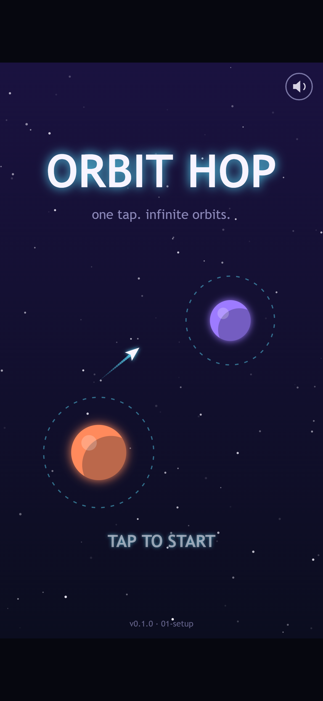
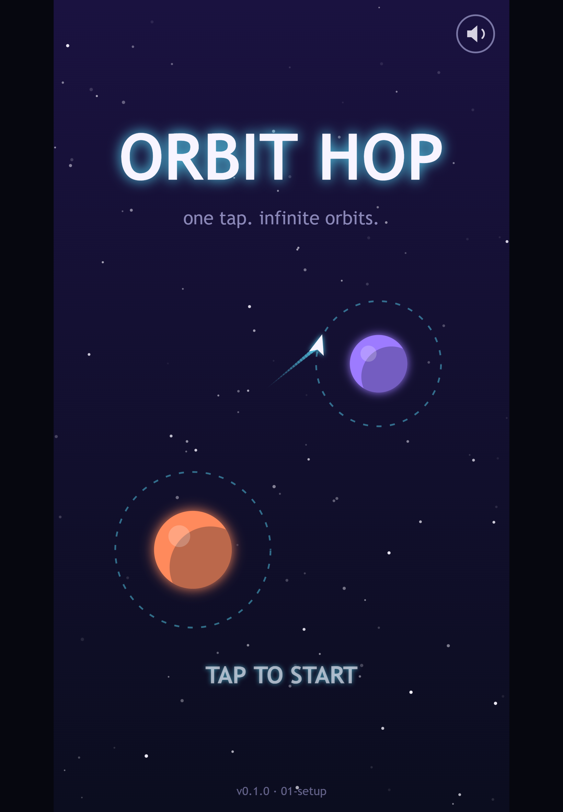
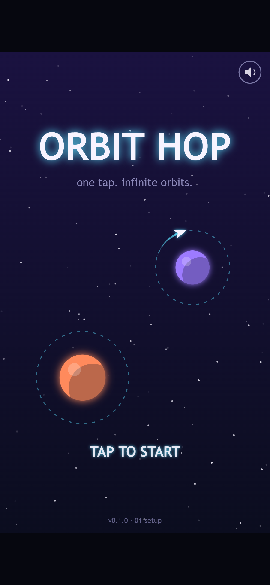

Welcome to the first Orbit Hop devlog! Over the next few posts we'll build a small HTML5 game from a blank folder to a finished release, and we'll show you every step on the way. Every screenshot in this series comes from a real build of the game at that stage. No mockups, no concept art painted after the fact.

This first post covers the idea: what Orbit Hop is, how it plays, and why we picked it.

*The title screen on a phone. The little ship has just let go of the orange planet and is heading for the purple one.*

## The pitch

Orbit Hop is a one-button arcade game. Your ship circles a planet on its own. Tap, and it lets go and flies off in a straight line, along the tangent of its orbit. Time it right and the next planet's orbit ring catches you. Time it wrong and you drift off into space.

That's the whole game: hop from planet to planet, up through a sector, until you reach the beacon at the top.

## How a hop works

Each hop takes somewhere between 5 and 20 seconds, and it goes like this:

1. **Orbit.** The ship circles the current planet's ring automatically.
2. **Read.** You look at the planets above you and work out where a straight line from your ship will go.
3. **Release.** You tap. The ship flies straight, leaving a trail behind it.
4. **Catch or miss.** If the ship crosses another planet's ring, it's captured and starts orbiting that planet. If it doesn't, it's gone.
5. **Scroll.** The camera moves up and the next planets come into view.

There's gold stardust along the way, too. You get bonus points for collecting it, which tempts you into riskier lines.

*A split second before the catch. The dashed ring around the purple planet is what you're aiming for.*

The title screen already plays this loop by itself. The ship orbits, lets go, gets caught, and does it again. We wanted the very first thing you see to show you how the game works, so you know what to do before you've read a single word.

## Winning and losing

- **You lose** if the ship flies off the screen without being caught, or if it crashes into a planet (or, later on, an asteroid). You restart the sector straight away. There's no game-over menu to click through.
- **You win** by reaching the beacon at the top of each sector. There are three sectors, about 8, 10 and 12 hops long, and each one adds a twist. Sector 1 has planets that stay put. Sector 2 adds moving planets and asteroids. Sector 3 has smaller rings and planets that orbit each other.
- **Your score** is hops plus stardust plus a time bonus. Each sector keeps its own best score, so you've got a reason to go back and do it faster.

## Why this idea?

We had a few must-haves for the first game out of the pipeline, and Orbit Hop ticks all of them.

**It's small enough to polish.** There's one mechanic and one input. We don't need a physics engine, pathfinding or a level editor. That means we can spend our time making it *feel* good, instead of just getting it working.

**It plays the same everywhere.** One input works with a mouse click, the space bar or a thumb. It plays in portrait, so you can hold your phone in one hand. There's no virtual joystick, and there are no controls to learn.

*On a phone the prompt says "TAP TO START". On desktop it says "CLICK OR PRESS SPACE". It's the same single input either way.*

**It looks good in a screenshot.** Glowing rings, bright planets and trails read well in a still image. That matters for a game that'll be shown off in posts like this one.

**There's nothing to license.** Every planet, ring, star and ship is drawn in code. The sound effects are synthesised blips for now. If we add music or recorded sound effects later, they'll be CC0 (free to use with no strings attached), and we'll list every one.

**There's lots of room for juice.** Once the basic hop works, there's plenty to add on top: a snap when you're caught, screen shake, trail particles, a slow-motion moment on a near miss, and a combo bonus for quick hops.

## What we're *not* building

Keeping a game small means saying no to things. For Orbit Hop that's ads, online leaderboards, accounts, a level editor, unlockable ships and a story. Some of those might come back one day, but they're not part of this version.

## The look

We went for neon vector space. Planets are flat and glowing, in coral, violet, mint and pink. Orbit rings are dashed cyan circles that slowly rotate. The ship is a small white chevron with a cyan trail, and it all sits on a deep indigo background with a twinkling starfield.

The game is built on a tall 540×960 canvas, the same shape as a phone screen. On a wider screen like a laptop, it sits in the middle with dark bars on either side.

## What's next

In the next post we'll go behind the scenes on the tech: why we skipped the big game frameworks and wrote our own tiny engine instead, and how we take these screenshots automatically.

Thanks for reading, and see you in Devlog #2!
