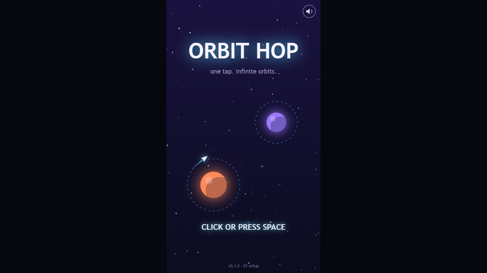
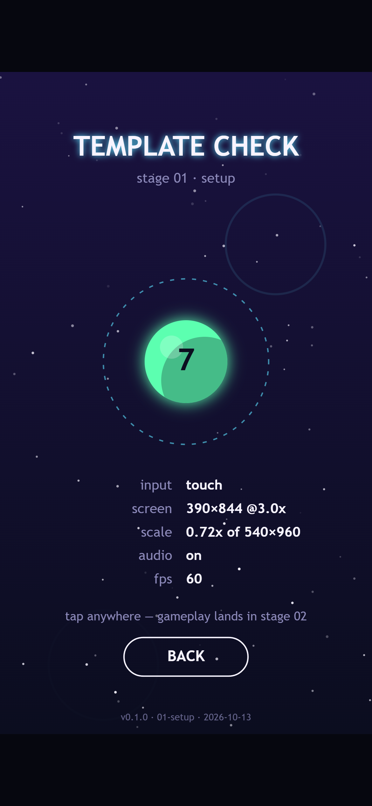
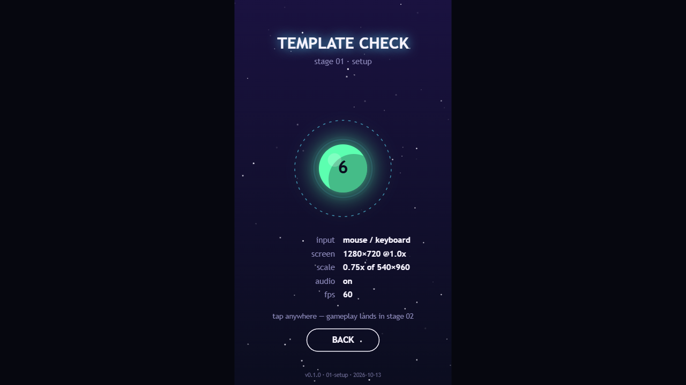

Welcome back! In [Devlog #1](../orbit-hop-devlog-1-the-idea/) we introduced Orbit Hop, a one-tap game about hopping between planet orbits. This time we're going behind the scenes on the tech: what the game is built with, how the project is laid out, and the little tools that make the whole thing easier to build (and to write about).

There's no gameplay yet. That comes next time. But by the end of this stage we had a title screen, a test screen and a project template we can reuse for every game after this one.

## Choosing an engine (or not)

The obvious choice for a 2D browser game is a framework like Phaser. It's great, and it can do almost anything. But Orbit Hop doesn't need almost anything. It needs a loop, a few screens, touch and keyboard input, some sound and a way to save your best score.

So we went with **plain TypeScript and the browser's built-in Canvas 2D**, and wrote the small engine ourselves. Here's why:

- **It's tiny.** The whole game currently downloads as one JavaScript file of about 12 KB. A framework alone can be close to a megabyte. That matters on a phone with patchy signal.
- **Nothing to fight.** When something behaves oddly, it's our own short, readable code, not a big library we have to dig through.
- **No dependencies to babysit.** The game ships with zero third-party code. There's nothing to update and no licenses to keep track of.
- **It's easy to explain.** Every system is a few dozen lines, which makes it much nicer to show off in posts like this one.

For building, we use **esbuild**, which bundles the whole game in a fraction of a second. **TypeScript** in strict mode catches a lot of silly mistakes before anyone has to play-test them.

If a future game needs heavy physics or big tile maps, we'll reach for a framework for that game. For a one-button game like this one, small and simple wins.

## The engine in six pieces

The reusable engine is a handful of short files. None of them knows anything about planets or ships, so they'll carry straight over to the next game.

- **The game loop** updates the game exactly 60 times a second, no matter how fast your screen refreshes. That keeps the game behaving the same on a cheap phone and a 144 Hz gaming monitor. It also handles switching between screens with a quick fade through black.
- **The view** handles screen sizes. The game is always drawn on a 540×960 canvas, the shape of a phone held upright. The view scales that to fit any window and adds bars on the sides when there's spare room. It also draws at your screen's full pixel density, so everything stays sharp on high-resolution phones.
- **Input** turns mouse clicks, screen taps, pen presses and key presses into a single "primary" action. The game just asks "was the button pressed?" and doesn't care whether it was a thumb or the space bar.
- **Audio** creates simple sound effects on the fly with the Web Audio API, so we don't need any sound files yet. It also takes care of a browser quirk: sound can't play until the player has tapped or pressed something.
- **Storage** saves things like your mute setting and best score. It's written so it never crashes the game, even in private browsing modes that block saving.
- **Math helpers** cover the usual small stuff: easing curves, random numbers and a seeded random generator, so the same level can be generated the same way every time.



*The title screen on a 1280×720 desktop window. The game area stays phone-shaped and sits in the middle, with dark bars filling the rest.*

In the game code, each screen (we call them scenes) is just an object with an `update` function and a `render` function:

```ts
class MyScene implements Scene {
  constructor(private game: Game) {}
  update(dt: number) {
    if (this.game.input.pressed("primary")) {
      // tap, click or space bar
    }
  }
  render(ctx: CanvasRenderingContext2D) {
    // draw the scene
  }
}

game.go(new MyScene(game)); // fades out, then in
```

That's the whole contract. The title screen, the test screen, and soon the actual game are all built this way.

## A title screen that already plays the game

We didn't want a static title screen. The one in this build runs a little demo of the real mechanic: the ship circles the orange planet, lets go at just the right moment, and gets caught by the purple planet's ring. Then it does it again, back and forth.

It also has a pulsing start prompt, which says "TAP TO START" on touch screens and "CLICK OR PRESS SPACE" on desktop. There's a mute button in the corner, and a small version stamp at the bottom so we always know which build a screenshot came from.

## The template check screen

Tap the title screen in this build and you get our **template check** screen. It's not part of the final game. It's there to prove the foundations work on whatever device you open it on.



*The check screen on a phone-sized screen. It has counted 7 taps and shows touch input, 390×844 at 3x pixel density, sound on and a steady 60 fps.*

Every tap makes a ripple and plays a note from a five-note scale, so you can hear that sound works. Underneath, it shows live readouts:

- **input:** whether you're using touch or a mouse and keyboard
- **screen:** your window size and pixel density
- **scale:** how much the 540×960 game area has been scaled to fit
- **audio:** on or muted
- **fps:** frames per second



*The same screen on desktop, after pressing the space bar six times. It picks up mouse and keyboard input instead of touch.*

It's a quick way to open the build on a new phone and check that taps, scaling, sound and frame rate all behave before we go any further.

## The tools around the game

A few small scripts handle the day-to-day work:

- **Dev server with live reload.** Save a file and the browser refreshes by itself.
- **Build and preview.** One command makes the release build. Another serves it and prints an address you can open on a phone on the same Wi-Fi, which makes testing on real devices painless.
- **Snapshots.** At the end of every stage, we freeze a copy of the game into its own folder, like `builds/01-setup/`. Snapshots are never overwritten. You can open one by double-clicking it, with no tools installed. That means we can always go back and play the game exactly as it was at any point in this devlog.
- **Automated screenshots.** This is the one we're most excited about. A small script opens a snapshot in a hidden Chrome or Edge window, pretends to be a desktop, phone or tablet, lets the game run, taps where we tell it to, and saves a screenshot.

Every image in this post (and the last one) came from that screenshot script, run against the real `01-setup` build. When we write about a stage, we're showing you exactly what the game looked like at that point.

## What we've got so far

- An idea and a design brief (see [Devlog #1](../orbit-hop-devlog-1-the-idea/))
- A tiny engine with no third-party code
- A title screen that demos the core mechanic
- A test screen that proves input, scaling, sound and frame rate on any device
- Snapshots and automated screenshots for every stage from here on

## What's next

Next up is the fun part: making it playable. In Devlog #3 we'll get the ship hopping for real, with planets to aim for, a camera that follows you up the screen, and the first proper "catch or miss" moment.

See you then!
