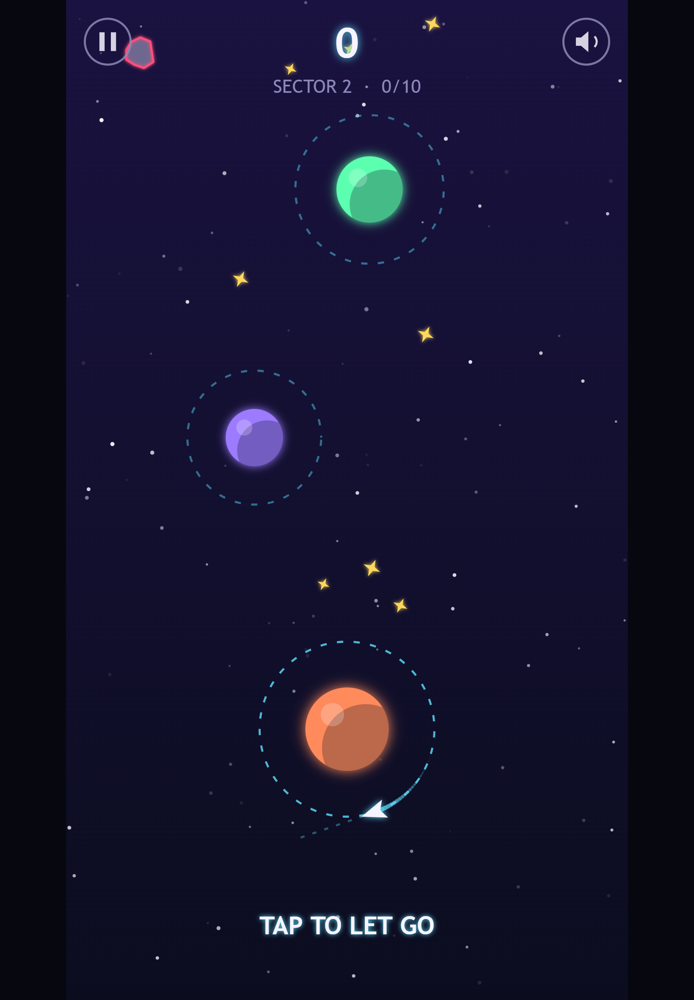
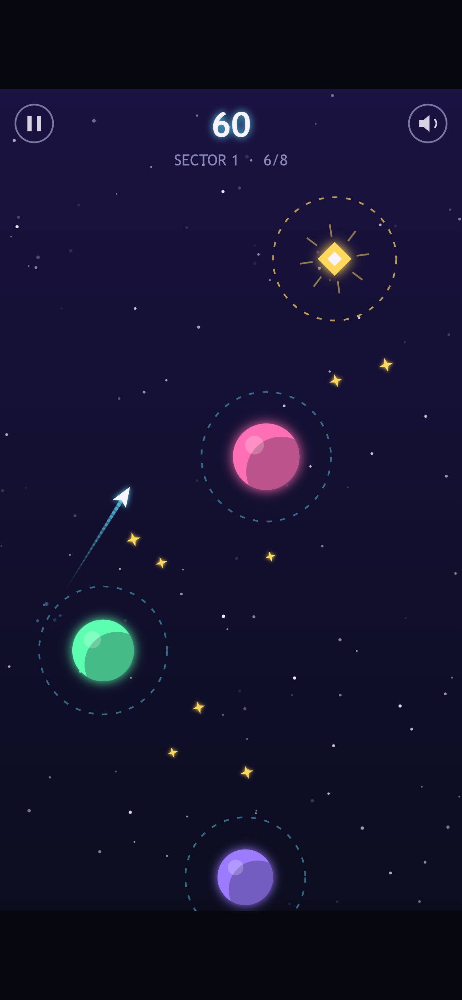
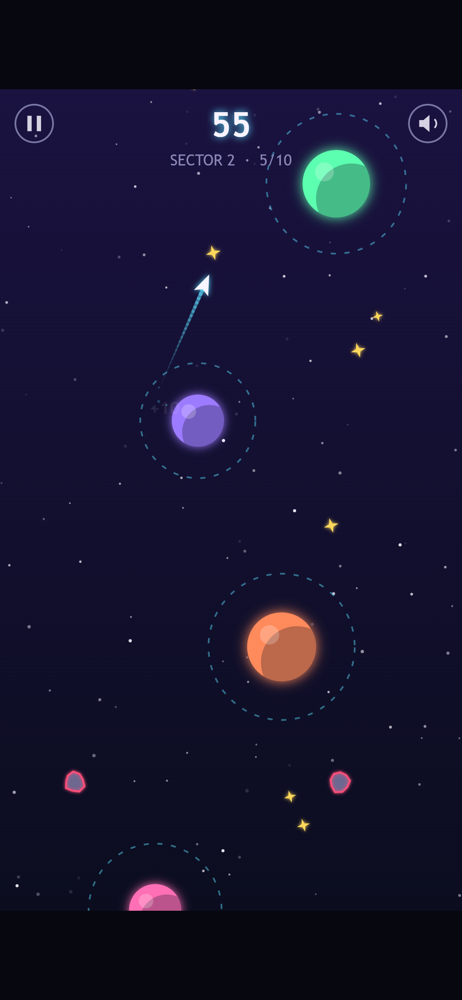
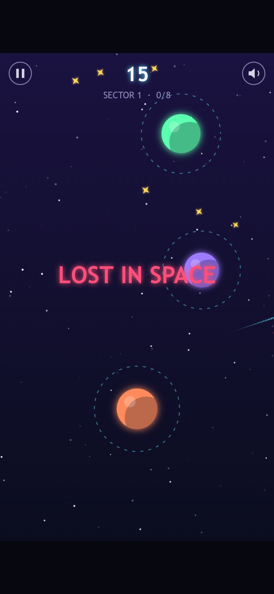
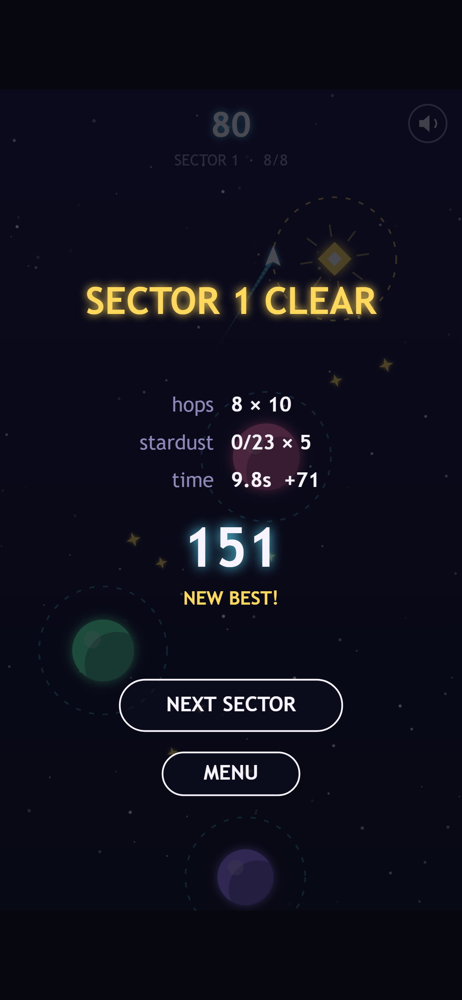
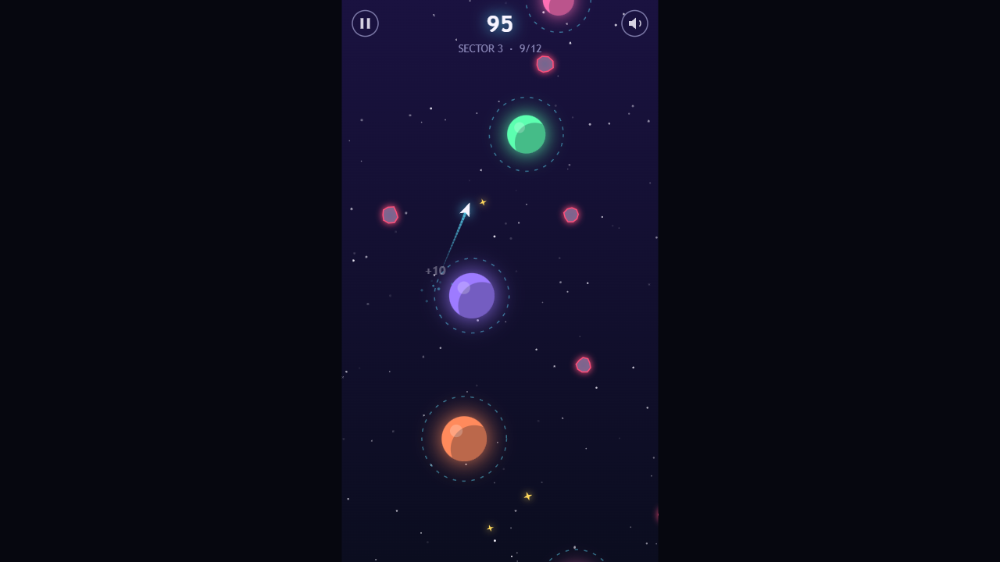

Welcome back! In [Devlog #2](../orbit-hop-devlog-2-setting-up-the-tech/) we built the engine, a title screen and a screenshot robot, but nothing you could actually play. This stage fixes that.

Orbit Hop is now playable from start to finish. There are three sectors to fly through, a score to chase and a quick way to fail and try again. This post covers how the core loop works, how we built the levels, and how a small bot helped us tune the difficulty.

*The start of sector 2 on a tablet. The short dashed line in front of the ship shows where it will go if you let go right now.*

## The core loop: orbit, read, let go

The whole game is one action. Your ship circles a planet on a dashed ring. Tap the screen (or click, or press Space, Enter or the up arrow) and it lets go, flying off in a straight line in whatever direction it was heading at that moment.

If that line crosses another planet's ring, the ship gets caught and starts circling the new planet, still going the same way round. If it misses, it drifts off into space.

So each hop is a small loop of its own:

1. **Orbit.** The ship goes round at a steady speed.
2. **Read.** You look at where the next ring is and wait for the ship to point at it.
3. **Let go.** Tap, fly, and either get caught or get lost.

While you're orbiting, a short dashed aim guide sticks out in front of the ship. It's deliberately short. It tells you which way you're facing without solving the puzzle for you.

After every catch, the camera eases up the screen so the next one or two planets are always in view. You never have to aim at something you can't see.

*Mid-hop in sector 1, heading for the pink planet. The glowing gold beacon at the top is the finish line.*

## Three sectors, built from seeds

The game has three sectors, and each one ends at a gold **beacon**. Reach it and the sector is clear.

- **Sector 1** is 8 hops between planets that stay still. It's there to teach the one rule.
- **Sector 2** is 10 hops. Planets now sway gently from side to side, and lanes of asteroids cross some of the gaps.
- **Sector 3** is 12 hops with smaller rings, faster swaying and more asteroids.

We don't draw the levels by hand. Each sector is generated from a **seed**, a number that feeds a random number generator. The same seed always produces the same layout, so the planets are in the same places every time you play.

That matters for a game like this. When you miss, you get the exact same puzzle again, and you can learn it. Retrying feels like getting better, not like rolling the dice.

*Sector 2 adds swaying planets and asteroids, the red-outlined rocks near the bottom. A faint "+10" is fading out by the purple planet the ship just left.*

## Failing fast

There are two ways to lose: drift off the edge of the screen, or fly into an asteroid. Either way you get a burst of particles, a little screen shake and a "LOST IN SPACE" message. Then the sector restarts by itself about 0.9 seconds later.

There's no game-over menu and no "Try again?" button. A small counter keeps track of your attempts, and that's it. In a game where each try lasts a few seconds, every extra tap between you and the next try is a reason to stop playing.

*We let go far too early on purpose. The trail on the right is the ship heading off screen.*

## Scoring

Scores were simple to add, and they give you a reason to replay a sector you've already beaten:

- **10 points** for each new planet you reach. If your flight skips a planet and lands on the one after, you get the points for both.
- **5 points** for each piece of gold stardust you fly through.
- **A time bonus** if you finish under par. Par is 3 seconds per hop, and every second you save is worth 5 points.

Your best score for each sector is saved on your device. Clearing a sector unlocks the next, and the title screen now has three sector buttons that show your bests.

*Sector 1 cleared in 9.8 seconds. Par for 8 hops is 24 seconds, so that's 14.2 seconds saved, worth 71 points. This run skipped the stardust entirely.*

Skipping planets and the time bonus work nicely together. A long, well-aimed flight past a planet is quicker but riskier, so speedy players can trade safety for points, while careful players can still hop one planet at a time and finish.

## A robot that plays every level

Generating levels from seeds has one big risk. What if a seed makes a sector that can't be beaten, or one where the timing is impossibly tight?

To check, we kept the game's rules completely separate from the drawing and sound code. That means a script can run the real game logic with no screen at all. Our level checker does exactly that. A bot tries letting go at every possible moment of every orbit, and records which moments lead to a catch.

The number of moments that work is the **timing window** for that hop. It's measured in frames, and there are 60 frames in a second. The checker fails if any sector can't be finished, or if any hop's best window is shorter than 8 frames (about 130 milliseconds).

On the current build, every sector passes. The tightest windows are 10 frames in sector 1 and sector 3, and 12 in sector 2.

It also told us what to change:

- **The ship was too fast.** Sector 1's windows were too tight for a tutorial, so orbit speed went down from 230 to 200 pixels per second.
- **Sector 3 was too mean.** We made its rings a little bigger, slowed the swaying and tried new seeds until every hop had a window of at least 10 frames.
- **Stardust was too easy.** Some sparkles sat so close to a ring that you collected them just by orbiting. They now keep a clear gap from every ring.

*Sector 3 on desktop. The rings are noticeably smaller and there are more asteroids. It's still fully beatable, and the bot checks that.*

One more honest note: the design brief planned for sector 3 to have planets that orbit each other. For now we swapped that for "small rings and faster drift", which was quicker to make fair. We may come back to it.

## Small touches (for now)

None of the effects are final, but even rough ones make a big difference to how the game feels:

- a snap sound on every catch, rising one note higher with each hop
- a flash on the ring that caught you, and a puff when you let go
- a chime for stardust, and a little tune when you clear a sector
- floating "+10" numbers where you score

There's also a pause button on screen (phones don't have a P key), a mute button, and the game pauses itself if you switch tabs. The whole game is still a single file of about 26 KB.

Every screenshot in this post came from our screenshot robot, run against the frozen `02-prototype` build. For the mid-flight shots, a helper plays the sector through the real game, then freezes the frame we want.

## What we've got so far

- A tiny engine, a title screen and our screenshot tools (see [Devlog #2](../orbit-hop-devlog-2-setting-up-the-tech/))
- A one-button core loop that's playable on phone and desktop
- Three seeded sectors with swaying planets and asteroids
- Instant retries, scoring, saved best scores and sector unlocks
- A level-checking bot that proves every sector can be beaten

## What's next

The game works, but it still feels like a prototype. Next comes the polish stage, which game developers like to call adding "juice": better trails and particles, punchier catches and crashes, and ideas like a moment of slow motion on a near miss and bonus points for quick chains of hops. We'll show the before and after in Devlog #4.

See you then!
