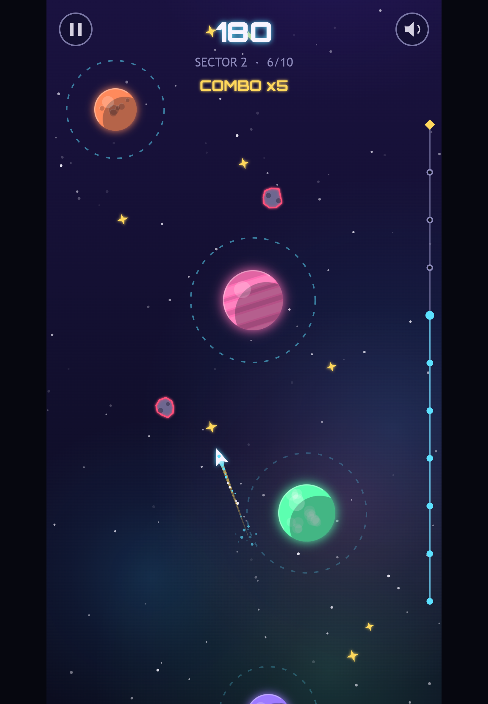
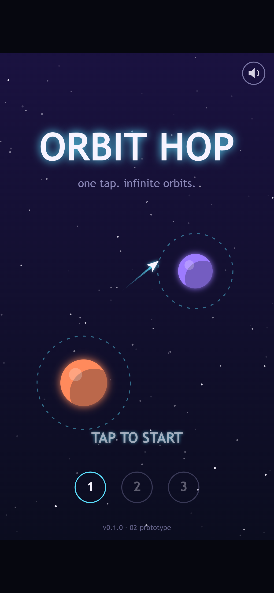
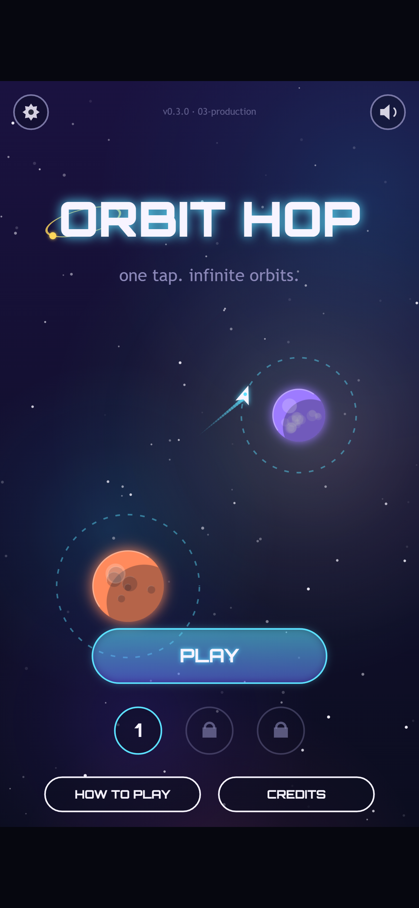
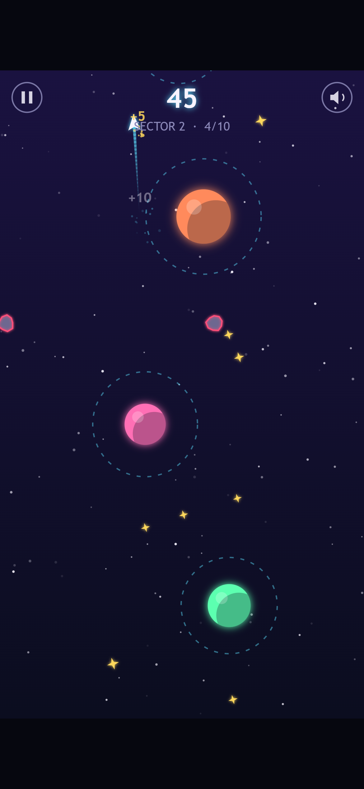
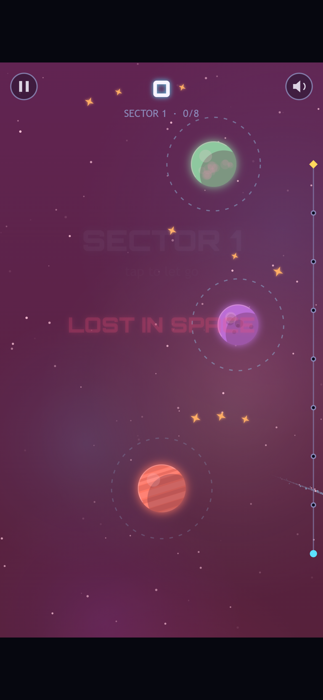

Welcome back! In [Devlog #3](../orbit-hop-devlog-3-first-playable/) Orbit Hop became playable: three sectors, one button and instant retries. It worked, but it looked and sounded like a prototype.

This stage was all about polish. The rules barely changed. What changed is how the game looks, how it sounds and how it responds when you play. Game developers call that last part "juice". In this post we'll put the prototype and the new build side by side, so you can see exactly what changed.

*Sector 2 on a tablet with a x5 combo going. The track on the right shows how far up the sector you are, with the beacon at the top.*

## Before and after: the title screen

Here's the title screen from the prototype build, then the same screen from the new production build. Both were captured on a phone a few seconds after the game loaded.

*Before: the prototype. It did the job, but the planets were flat balls and the only instruction was "TAP TO START".*

*After: a proper main menu. The PLAY button picks up from your furthest sector, and sectors you haven't reached yet show a lock.*

A few things to look for:

- **The font.** Titles and numbers now use Orbitron, a free, open-licensed font with a squared-off sci-fi look. Everything else stays in your device's normal font so it's easy to read.
- **The planets.** Every planet now has a surface: gas bands, craters or continents, plus a light edge and a soft glow.
- **The background.** A faint coloured nebula drifts behind the stars. It moves more slowly than the stars as the camera climbs, which gives a sense of depth.
- **The menus.** There's now a settings gear, a How to Play screen with little animated cards, and a Credits screen.

All of the art is still drawn by code at runtime. There isn't a single image file in the game. That keeps it small and sharp on any screen.

## Before and after: in the middle of a hop

The title screen is nice, but you spend most of your time mid-flight. So here's the exact same moment in both builds. It's sector 2, just after the fourth hop, with the same timing for every tap.

*Before: the prototype. Same planets, same flight path, score 45.*

*After: the same moment, now worth 84 points. The gold trail and "COMBO x3" mean these hops came quickly enough to build a streak.*

The planets and rocks are in exactly the same places. Everything around them is new.

The biggest change here isn't art, though. It's the **combo**. If you hop again before you finish one full lap of your current ring, your streak grows, and each planet is worth 10 points times the streak, up to x5. A gold arc on the ring shows how much of the lap you have left, and it turns red when time is nearly up. The first time you hit x2, a tip pops up to explain it.

That gives the game a second layer. Careful players can still hop one planet at a time. Players who want a high score have a reason to go faster and take risks.

We also added **close calls**: skim within 18 pixels of an asteroid without hitting it and you get 15 bonus points and a brief moment of slow motion.

To see how much the combo matters, we replayed the same sector 1 run in both builds. In the prototype it scored 151. In the new build, with a best combo of x4, the same run scores 251.

## Making it feel good

"Juice" is the set of small reactions that make a game feel alive when you touch it. None of them change the rules, but together they make each hop feel satisfying. Here's what we added:

- **Catching a planet** sends a ripple out across the ring, and the score pops and counts up instead of just changing.
- **Floating score numbers** get bigger as your combo grows. A x5 hop really looks like it's worth more.
- **The ship** now has an engine flame and gives off little sparks. On a combo, its trail turns gold.
- **Rings you've passed** fade out, and the ones ahead stay bright, so your eye goes to where you need to look next.
- **Each sector** opens with a banner that slides in, and clearing it gives a gold flash and a burst of confetti.
- **On Android phones**, the game vibrates gently when you catch a planet, crash or win.

Crashing got the most attention, because you'll do it a lot. Hitting an asteroid now breaks the ship into shards, sends out a shockwave and flashes the screen red. The game also freezes for 80 milliseconds, less than a tenth of a second. That tiny pause is called hit-stop. You barely notice it consciously, but it makes the impact feel solid.

*We let go far too early again, on purpose. This time the screen flashes red when the ship is lost.*

All of this has a limit. Screen shake and vibration can be switched off in the new Settings screen, alongside music and sound effects. Some players find shake uncomfortable, and nobody wants their phone buzzing on the bus.

## A soundtrack made of code

Like the art, the music and sound effects aren't files. They're generated live by the browser's built-in audio system.

The music is a calm loop of four chords at 88 beats per minute, with a soft pad, a bass line and bells. When you're playing, an echoing arpeggio (the notes of each chord played one after another) joins in. When your combo reaches x3, a soft kick drum and hi-hat fade in. The music builds as you play better, without you having to think about it.

The sound effects got the same treatment. There's a whoosh when you let go, and a snap when you're caught that climbs one note higher with each hop and sparkles on a combo. Stardust chimes, close calls swoosh, crashes crunch, and clearing a sector plays a fanfare. Music and sound effects have separate volume switches, so you can keep the bleeps and lose the soundtrack, or the other way round.

## What it cost

Polish isn't free. The whole game grew from about 26 KB to about 70 KB. Around 16 KB of that is the Orbitron font, which we pack inside the game file so it still works when opened straight from a computer's disk. That's still smaller than most single photos on a web page.

Our level-checking bot from the last post still passes every sector, with the same timing windows as before. The new look didn't change how the game plays, only how it feels.

Every screenshot in this post came from our screenshot robot, run against the frozen `02-prototype` and `03-production` builds. For the mid-flight shots, a helper plays the sector through the real game, then freezes the frame.

## What we've got so far

- A tiny engine, a title screen and our screenshot tools
- A one-button core loop with three seeded sectors, checked by a bot
- A full set of menus: main menu, How to Play, Settings, Credits, pause and a victory screen
- Hand-coded art for planets, ship, asteroids and nebula, plus the Orbitron font
- A generated soundtrack that builds with your combo, and new sound effects
- Combos, close calls and a lot of juice

## What's next

The game looks and sounds the way we want. Next comes testing: playing it on real phones and desktops, hunting bugs, checking performance and making sure it loads fast. We'll share what broke and how we fixed it in Devlog #5.

See you then!
