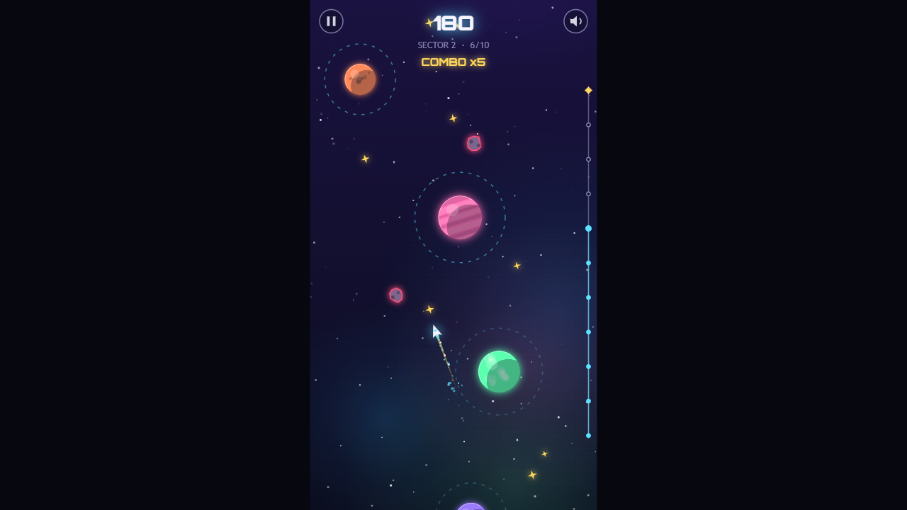
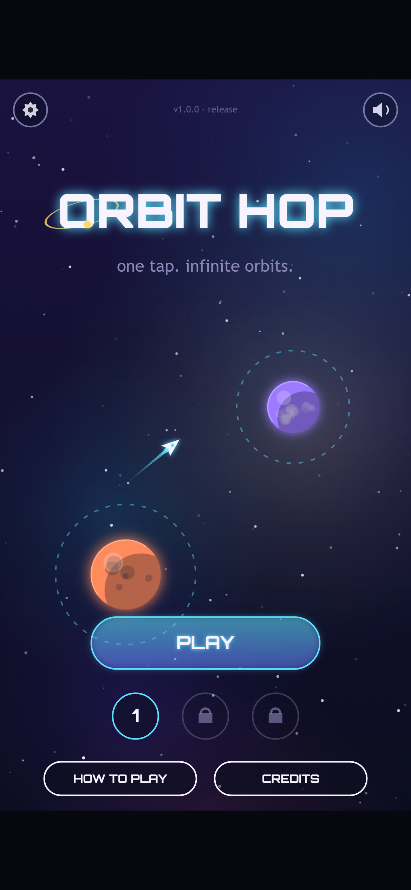

Hello again! In [Devlog #4](../orbit-hop-devlog-4-look-and-feel/) Orbit Hop got its art, music and juice. It looked finished. But "looks finished" and "works on everyone's phone" are two different things.

This stage was testing. We ran the game in three browsers at four screen sizes, hunted bugs, and made it faster on slower devices. This post covers what broke, how we fixed it, and why the most important bug was one that none of our automated tests could catch.

*A phone held sideways. Orbit Hop is a tall game, so it shrinks to fit. Now it politely asks you to turn the phone round.*

## A robot that plays the whole game

For testing we built a new tool that opens the game in a real browser and plays it like a person would. It runs in Chrome, Edge and Firefox, at four sizes: a desktop window, a phone, a phone held sideways, and a tablet.

At every size, in every browser, it does five things:

1. **Opens every screen** (menu, all three sectors, How to Play, Settings, Credits, Victory) and checks that nothing throws an error.
2. **Clicks through the menus** with real taps and clicks: PLAY, the tutorial, pause, resume, back to the menu.
3. **Checks the sound** switches on after the first tap.
4. **Plays all three sectors** from start to finish in real time, presses NEXT SECTOR and FINISH, and checks the Victory screen appears and the game has saved your progress.
5. **Rotates the screen** mid-game and hides the browser tab, to check the game resizes and pauses itself.

That's 60 checks over a normal web address. We ran another 30 with the game opened straight from the computer's disk, the way you would if you downloaded it. The final build passes all 90.

*The robot's final scores on the Victory screen: 251, 494 and 577. It got exactly these numbers in every browser, every time.*

## The same score, everywhere

That last caption is our favourite result from this stage. Chrome and Edge use one browser engine and Firefox uses a completely different one. Yet the robot scored exactly 251, 494 and 577 in all of them, on every screen size.

This isn't luck. Back in the prototype we kept the game's rules separate from its drawing code, and every sector is built from a fixed seed (a starting number that always produces the same layout). So the game plays out identically wherever it runs. A retry really is the same puzzle, on any device.

We also re-ran our level checker. All three sectors are still beatable, and the tightest moment in the game still gives you about 170 milliseconds to tap. That's comfortably human.

*Sector 2 in a desktop browser, six hops in on a x5 combo. On a wide screen the game sits in the middle with dark bars either side.*

## What broke, and how we fixed it

Testing turned up five bugs and one speed problem. Here they are, most important first.

- **No sound on real phones.** This was the big one, and it gets its own section below.
- **Blank menus on older browsers.** Every button in the game is a rounded rectangle, drawn with a fairly new browser feature. Safari before version 16 and Firefox before version 112 don't have it, so the first button would crash the screen. We added a small stand-in (developers call it a polyfill) that draws the same shape the old-fashioned way.
- **An error in Firefox when leaving the page.** When you switch tabs, the game pauses its audio. Firefox sometimes complains if that happens while the page is closing. It was harmless, but it made 12 of our Firefox checks fail on the first run. Now the game quietly ignores that complaint.
- **Keyboard players stuck on the Victory screen.** You could only leave it with a click or Esc. Space and Enter now take you back to the menu too. While we were there, we fixed "best combo x0" showing up after you reset your progress.
- **Slow frames on slower devices.** On a device without graphics acceleration, one frame took 19 milliseconds to draw. To run smoothly at 60 frames a second, it needs to be under about 16. Most of that time went on the soft nebula clouds in the background. Since they're blurry anyway, we now draw them at half size and stretch them up. That brought it down to 11 milliseconds, and you can't tell the difference.
- **Phones held sideways.** The game is tall and thin, so on a sideways phone it shrinks to about 40% of the screen. That's by design, but there was no hint about why. Now a pulsing message in the empty space asks you to turn your phone upright. It only shows on touch screens.

## The bug no robot could see

Here's the twist. Our robot passed every audio check on every phone size. Sound worked perfectly in testing. On a real Android or iPhone, it would have been silent.

Phones don't let a web page play sound until you've touched the screen. That's a good rule, since nobody wants a page blaring at them. The catch is in the detail: phones only count the *end* of a tap, when your finger lifts off, as permission. Our game asked for sound at the *start* of a tap, when your finger first lands. The phone said no, and the game never asked again.

The robot couldn't catch this, because its pretend taps count as permission straight away. We found it by reading the code and checking it against the rules browsers follow. The fix is simple: the game now asks for sound on every tap, click or key press, at the start and the end, until the sound is actually on.

*The release build's main menu on a phone. Your first tap anywhere now switches the sound on, and the speaker in the corner mutes it.*

The lesson for us: automated tests are brilliant for catching the same mistake twice, but they only check what you thought to ask. Somebody still has to read the code.

## What we haven't tested yet

We want to be upfront about the gaps:

- **Every phone result so far comes from emulation**, where a desktop browser pretends to be a phone. Before the game goes public, we'll play a round on a real Android phone and a real iPhone, starting with checking that the sound comes on after the first tap.
- **Safari wasn't tested directly**, because we don't have a Mac in the studio. We did fix the older-Safari problems we found by reading the code.
- **iPhones mute web games when the silent switch is on.** That's how iOS works, not a bug.
- **Vibration only works on Android.** iPhones don't let web pages vibrate.

## What we've got so far

- A tiny engine, a title screen and our screenshot tools
- A one-button core loop with three seeded sectors, checked by a bot
- Full menus, hand-coded art, a generated soundtrack and plenty of juice
- A testing robot that plays the whole game in three browsers at four screen sizes
- Five bugs fixed, faster drawing on slower devices, and a rotate hint for sideways phones
- A finished build: three small files, about 70 KB of game, that run from any web host or straight from your disk

## What's next

Orbit Hop is done. In Devlog #6 we'll show the finished game from start to finish, share some numbers, and look back on what we learned making it.

See you there!
