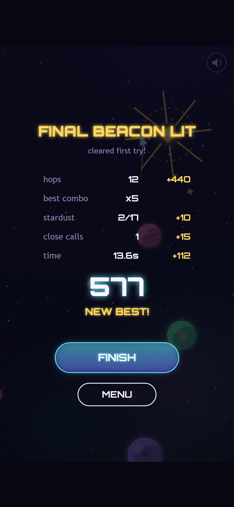
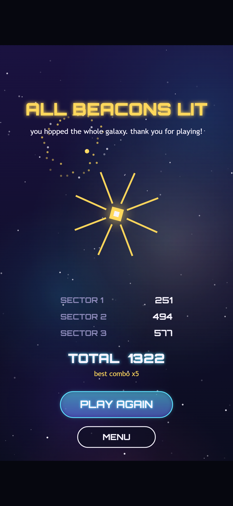

Hello, and welcome to the last Orbit Hop devlog! In [Devlog #5](../orbit-hop-devlog-5-testing-and-polish/) we tested the game in three browsers, fixed five bugs and found one that no robot could see.

That was the final stage. Orbit Hop 1.0 is finished. In this post we'll take one last tour through the game, share the numbers behind it, and look back on what we learned building it from a blank folder.

*Version 1.0 on a tablet. The little label at the top says "release" now, not "setup" or "prototype".*

## The game, start to finish

If you've just arrived, here's Orbit Hop in one paragraph. Your ship circles a planet on its own. Tap, and it lets go and flies in a straight line. If it crosses the next planet's ring, it's caught and starts circling that one. If it doesn't, it's lost in space. Hop your way up through the sector to light the beacon at the top.

There are three sectors, and each one adds something new:

- **Sector 1** has 8 hops between planets that stay still. It teaches you to read the line.
- **Sector 2** has 10 hops. The planets sway and there are lanes of asteroids to slip through.
- **Sector 3** has 12 hops, with smaller rings, faster drift and more asteroids.

Hop again quickly, before you finish one lap of your ring, and you build a combo worth up to five times the points. Skim past an asteroid without touching it and you get a close-call bonus. Crash, and you're back at the start of the sector in under a second.

*Deep in sector 3 on a phone, on a x5 combo. Each planet is worth 50 points at this streak, and three more hops reach the beacon.*

## Lighting the last beacon

Reach the top of a sector and the beacon lights up. Then a panel adds up your run: hops, best combo, stardust, close calls and a bonus for finishing quickly.

*The end of sector 3, cleared by our autoplay bot. It skips most of the stardust, so there are points left on the table for you.*

After sector 3, the FINISH button takes you to the Victory screen, with fireworks and your best score for each sector.

*The Victory screen on a phone, showing the bot's scores. Its total is 1,322. We'd love to hear if you beat it.*

## By the numbers

- **About 70 KB.** The whole game is one script file. Around 16 KB of that is the font.
- **Three files.** A web page, the game script and a small icon. It runs on any web host, or straight from your disk with a double-click.
- **Zero image or audio files.** Every planet, star and sound is made by code while the game runs.
- **One third-party asset:** the Orbitron font, which is free and open-licensed.
- **About 650 lines** of reusable engine code, plus about 2,650 lines for Orbit Hop itself.
- **30 hops** across three sectors, all checked by a bot that proves every level can be beaten.
- **90 out of 90** automated checks passing in Chrome, Edge and Firefox, on desktop, phone and tablet sizes.
- **Six devlog posts**, and every screenshot in them came from a real build of the game.

## What we learned

**1. Start tiny.** We picked a one-button game on purpose. With such a small game, every stage could get finished properly, instead of rushing a big game that's always half done. We'd make the same call again.

**2. Keep the rules apart from the drawing.** The single best decision in the project was keeping the game's rules in code that knows nothing about the screen or speakers. That's what let a bot play every level, check the timing is fair, and get identical scores in three browsers. It costs a little discipline at the start and saves a lot later.

**3. Freeze every stage.** At the end of each stage we saved a runnable copy of the game and never touched it again. That's how Devlog #4 could show exact before-and-after shots, and how this whole series could use real screenshots instead of mockups.

**4. Let robots do the boring parts.** A script took our screenshots, a bot tested the levels, and another bot played the full game in three browsers. None of that is glamorous, but it meant we could change things without worrying about what we'd quietly broken.

**5. But somebody still has to read the code.** The most serious bug we found, no sound at all on real phones, sailed through every automated test. A person reading the code caught it. Robots check what you ask them to. People notice what you forgot to ask.

**6. Code-made art and sound go a long way.** Drawing everything in code kept the game tiny and sharp on every screen, and the music could react to how well you're playing. It doesn't suit every game, but for a small arcade game it was a great fit.

And one thing we'd do differently: test on a real phone earlier. Desktop browsers do a good job of pretending to be phones, but not a perfect one, and we only found out because someone went looking.

## Where to play

Orbit Hop 1.0 works in any modern desktop or phone browser: tap, click, or press Space to hop. **[Play it right here on the Slop Factory site](../../games/orbit-hop/)**, no install, no account, no slop left behind.

## What we've got

- A finished one-button arcade game for desktop and mobile browsers
- Three hand-tuned sectors with combos, close calls and saved best scores
- Code-made art, music and sound effects that fit in about 70 KB
- A reusable engine and project template, with tools for screenshots, level checking and cross-browser testing
- Six devlog posts telling the whole story

## What's next

Orbit Hop was the first game through our studio's pipeline, and the template, tools and testing robot all carry straight over to the next one. Now we're writing up how the whole process went, so the next game starts faster. When it does, we'll be back with a brand new devlog series.

Thanks for following along!
