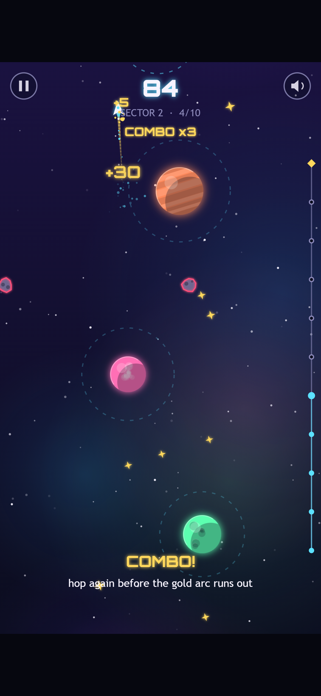
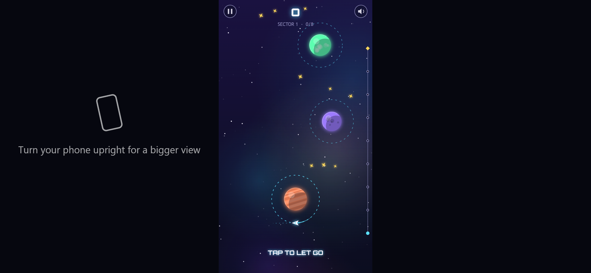

[Orbit Hop](/games/orbit-hop/) is a one-button arcade game for desktop and mobile browsers. Your ship circles a planet on its own. Tap, and it lets go and flies off in a straight line. If that line crosses the next planet's orbit ring, you're caught. If it doesn't, you're lost in space. Hop your way up three sectors to light the beacon at the top of each one.

This post covers the decisions behind it: why one button, how we kept generated levels fair, how the art and music are made without a single image or audio file, and the bug that every automated test missed. Every screenshot comes from a real build of the game.

*Sector 2 on a tablet with a x5 combo going. The track on the right shows how far up the sector you are.*

## One button, on purpose

We wanted a game small enough to polish properly. One mechanic and one input meant no physics engine, no pathfinding and no level editor, so the time could go into making each hop feel good rather than just getting it working.

One input also plays the same everywhere. A tap, a click and the space bar all do the same thing, and the game is tall, like a phone held upright, so you can play it one-handed. There's no virtual joystick and nothing to learn. The title screen even plays the loop by itself, orbiting, letting go and getting caught, so you know what to do before you read a word.

Each hop is a small loop of its own: orbit, read where the next ring is, let go. A short dashed aim guide shows which way the ship is facing without solving the puzzle for you, and the camera eases up after every catch so you never aim at something you can't see.

Failing is fast. Miss, and you get a burst of particles and a "LOST IN SPACE" message, and the sector restarts by itself under a second later. There's no "Try again?" button. When each try lasts a few seconds, every extra tap between you and the next try is a reason to stop playing.

We skipped the big frameworks, too. The game runs on plain TypeScript and the browser's canvas, and the finished game is one script of about 70 KB.

## Levels from seeds, checked by a bot

We don't draw the levels by hand. Each sector is generated from a **seed**, a number that always produces the same layout. Sector 1 has 8 hops between planets that stay still. Sector 2 has 10, with swaying planets and lanes of asteroids. Sector 3 has 12, with smaller rings and more asteroids. Because the layout never changes, a retry is the same puzzle again, and getting it right feels like getting better rather than getting lucky.

Generated levels have one big risk: a seed could produce a sector that can't be beaten, or one where the timing is impossibly tight. So we kept the game's rules in code that knows nothing about the screen or speakers. That let a script run the real game logic with no screen at all. A bot tries letting go at every possible moment of every orbit and records which ones lead to a catch. If any hop has a window shorter than 8 frames (about 130 milliseconds), the check fails.

*Sector 3 has noticeably smaller rings and more asteroids. The bot still proves every hop can be made.*

The bot also told us what to change. Sector 1 was too tight for a tutorial, so the ship slowed down. Sector 3 was too mean, so its rings grew a little and the swaying slowed. And some stardust sat so close to a ring that you collected it just by orbiting, so it now keeps a clear gap. One honest trade-off: we had planned planets that orbit each other for sector 3, and swapped them for smaller rings and faster drift, which were quicker to make fair.

## Code-drawn art and a soundtrack that builds

There isn't a single image file in Orbit Hop. Every planet, ring, star, asteroid and ship is drawn by code while the game runs, which keeps it tiny and sharp on any screen. The look is neon vector space: glowing planets with gas bands, craters or continents, dashed cyan rings, and a nebula that drifts more slowly than the stars to give a sense of depth. The only outside asset is Orbitron, a free, open-licensed font for titles and numbers.

The easiest way to show the art pass is the same moment in two builds: sector 2, just after the fourth hop, with every tap at the same time.

*Before: the prototype. Same planets, same flight path, score 45.*

*After: the same moment, now worth 84 points. The gold trail and "COMBO x3" mean these hops came quickly enough to build a streak.*

The biggest change there isn't art, it's the **combo**. Hop again before you finish one lap of your ring and your streak grows, up to x5 points. A gold arc shows how much of the lap you have left. Careful players can still hop one planet at a time; players chasing a score have a reason to take risks. Skimming past an asteroid without touching it adds a close-call bonus and a moment of slow motion.

The sound is made the same way as the art, generated live by the browser's audio system. The music is a calm four-chord loop. An arpeggio joins in when you start playing, and a soft kick drum and hi-hat fade in when your combo reaches x3, so the music builds as you play better. The catch sound climbs one note with each hop. Crashes get the most care, because you'll hear them a lot: the ship breaks into shards, the screen flashes red, and the game freezes for 80 milliseconds. You barely notice that pause, but it makes the impact feel solid. Screen shake and vibration can both be turned off in Settings.

## Three browsers, the same score

For testing we built a bot that opens the game in a real browser and plays it like a person: every screen, every menu, all three sectors from start to finish, plus rotating the screen and switching tabs mid-game. It ran in Chrome, Edge and Firefox at desktop, phone, sideways-phone and tablet sizes, both from a web address and opened straight from disk. The final build passes all 90 checks.

*The bot's scores on the Victory screen: 251, 494 and 577. It got exactly these numbers in every browser, every time.*

That's our favourite result. Firefox uses a completely different engine from Chrome and Edge, yet the scores matched to the point. It comes straight from keeping the rules apart from the drawing and using fixed seeds: the game plays out identically wherever it runs.

Testing still turned up real problems. Buttons crashed on older Safari and Firefox, so we added a stand-in for the missing drawing feature. The blurry nebula was slow on weaker devices, so it's now drawn at half size and stretched, which nobody can see. And on a sideways phone, the game now asks you to turn it upright.

*Sideways still works. The empty space now tells you how to get a bigger view.*

## The bug no robot could see

Our bot passed every sound check on every phone size. On a real phone, the game would have been silent.

Phones don't let a page play sound until you've touched the screen, and they only count the *end* of a tap, when your finger lifts, as permission. Orbit Hop asked for sound at the *start* of the tap. The phone said no, and the game never asked again. The bot's pretend taps count as permission straight away, so it couldn't catch this. We found it by reading the code against the rules browsers follow, and the fix was small: the game now asks on every tap, click or key press until the sound is actually on.

## What we'd do differently

Keeping the rules apart from the drawing was the best decision in the project. It's what made the level bot, the fair timing and the identical scores possible, and it cost only a little discipline at the start.

What we'd change is testing on a real phone sooner. Desktop browsers pretend to be phones very well, but not perfectly, and our most serious bug lived in that gap. Automated tests check what you thought to ask; somebody still has to read the code.

Orbit Hop runs in any modern browser, no install needed. [Come and light all three beacons](/games/orbit-hop/), and let us know if you beat the bot's 1,322.
