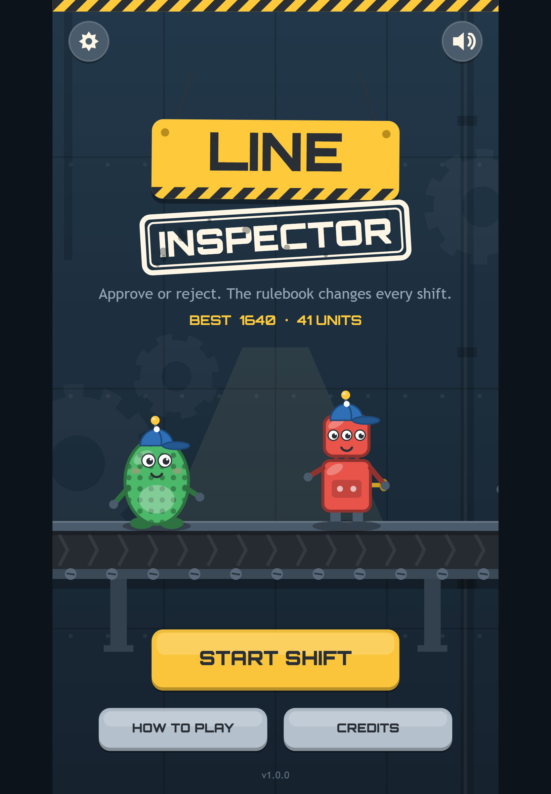

Wind-up robots, bouncy critters and pocket rockets roll down the line one at a time. You make one call on each: **approve** it or **reject** it. What counts as faulty is written in the **inspection rulebook**, and the rulebook changes every shift. A toy that was fine five minutes ago might be a reject now.

Every shift adds or changes a rule and gives you a little less time per toy. A wrong call or a missed toy is a strike, and the rule you missed lights up so you know why. Three strikes end the run, and the game-over card shows the toy and the rule behind each one.

## What's in the box

- Nine shifts of changing rules, then an endless final shift for as long as you can last
- Every faulty toy breaks exactly one rule, so every strike tells you what you missed
- Streaks, saved best scores and a short result line to share with friends
- Colour-blind friendly paint patterns, plus settings for sound, music, screen shake and vibration
- Art, music and sound effects all generated in code: the whole game is about 86 KB
- Works on desktop, phone and tablet browsers, best played upright on a phone

## Credits

Made by Slop Factory. All visuals, music and sound effects are original and generated at runtime. The display font is [Orbitron](https://github.com/theleagueof/orbitron) by Matt McInerney / The League of Moveable Type, used under the SIL Open Font License 1.1.
