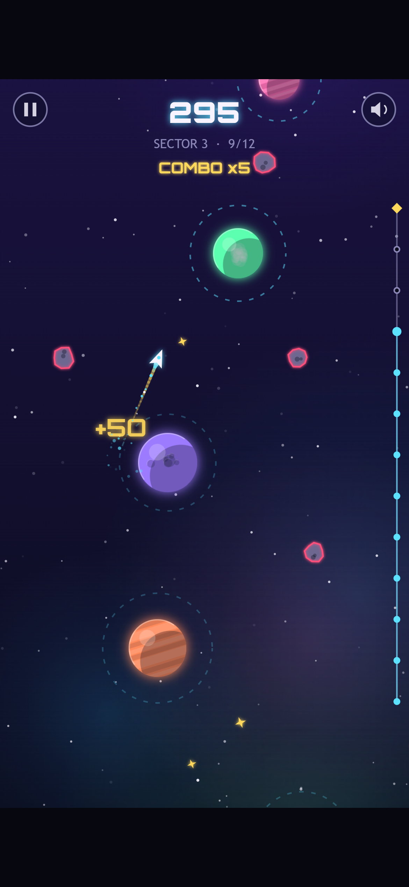
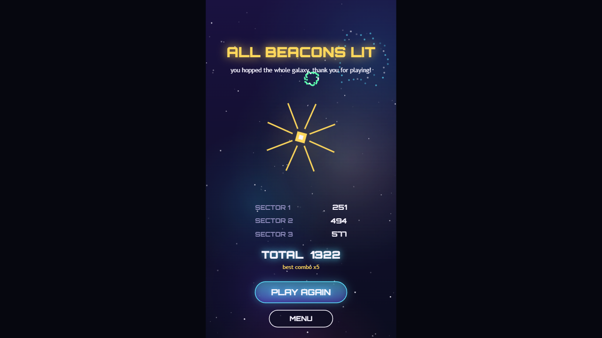

Your ship circles a planet on its own. **Tap, and it lets go**, flying off in a straight line along the tangent of its orbit. Time it right and the next planet's orbit ring catches you. Time it wrong and you drift off into the cold, slop-free void.

Hop from planet to planet, up through each sector, until you light the beacon at the top. Grab gold stardust for bonus points, chain hops for combos, and skim past asteroids for close-call bonuses.

## What's in the box

- Three hand-tuned sectors, each checked by a robot to make sure it can actually be beaten
- Combos, close calls, stardust and saved best scores
- Art, music and sound effects all generated in code: the whole game is about 70 KB
- Works on desktop, phone and tablet browsers

## Credits

Made by Slop Factory. All visuals, music and sound effects are original and generated at runtime. The display font is [Orbitron](https://github.com/theleagueof/orbitron) by Matt McInerney / The League of Moveable Type, used under the SIL Open Font License 1.1.
